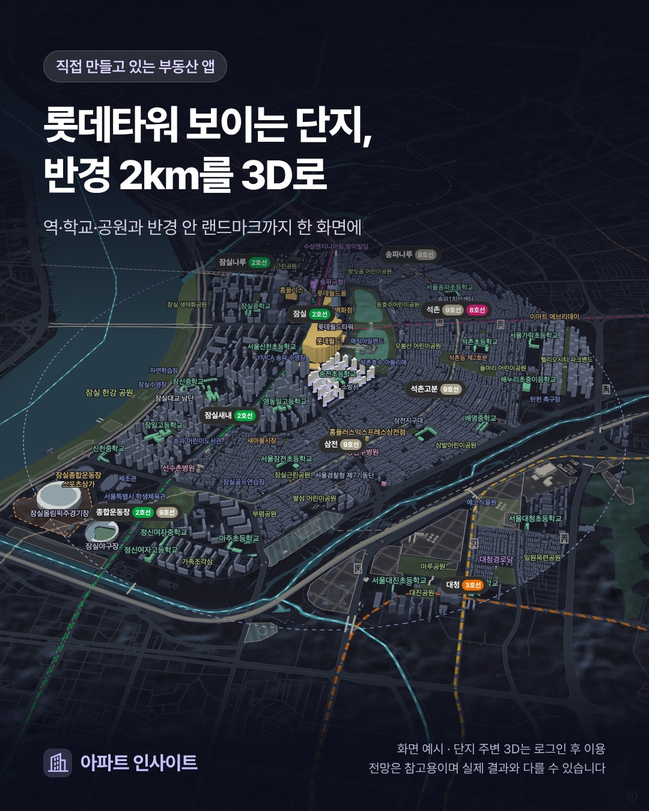

**같은 단지의 101동과 105동, 주변 생활환경도 비슷할까요?** 단지 주소는 같아도 가까운 도로와 건물, 공원 쪽으로 열린 공간은 다를 수 있습니다. 관심 매물의 동을 지도에서 먼저 찾아보면 현장에 가서 무엇을 확인할지 구체적으로 정할 수 있습니다.

아파트 3D 지도는 건물의 배치와 높이, 주변 시설을 함께 살펴보는 데 유용합니다. 화면을 한 바퀴 둘러보는 데서 그치지 않고 **내 동 → 가까운 주변 → 자주 이용할 생활시설** 순서로 읽어 보세요.

<!-- truncate -->

*실제 지도 캡처를 바탕으로 2026년 11월 1일 제작한 소개 이미지입니다. 이후 추가된 기능이나 현재 화면 구성과 차이가 있을 수 있습니다.*

*지도 데이터에는 [© OpenStreetMap 기여자](https://www.openstreetmap.org/copyright)의 자료가 포함됩니다.*

## 1. 내 동을 찾고, 방향을 바꿔 주변 건물을 봅니다

먼저 관심 매물이 있는 동을 찾아 주변 건물이 어느 쪽에 모여 있는지 살펴봅니다. 한 방향에서만 보면 뒤쪽 건물이 가려질 수 있으므로 지도를 돌려 보는 것이 좋습니다. 화면에서 가까워 보이는 느낌과 실제 거리도 구분해야 합니다.

| 확인할 대상 | 지도에서 볼 것 | 현장에서 이어서 확인할 것 |
| --- | --- | --- |
| 관심 동 | 단지 안 위치, 주변 동과의 배치 | 실제 출입구와 보행 연결 |
| 주변 건물 | 건물 높이와 어느 방향에 있는지 | 관심 층·호에서 보이는 범위 |
| 학교·공원·상업시설 | 시설 위치와 단지 사이의 관계 | 출입구, 이용 시간, 접근 동선 |
| 도로·철도 등 기반 시설 | 단지의 어느 면과 가까운지 | 시간대별 통행과 체감 소음 |
| 공사 중인 곳 | 표시된 위치와 주변 건물 | 현장 상태와 공식 사업 안내 |

예를 들어 **가상의 A동은 공원 쪽, B동은 큰 도로 쪽에 있다**고 해보겠습니다. 지도에서는 두 동의 위치 차이를 발견할 수 있습니다. 다음 질문은 “공원 입구가 어느 쪽인가”, “B동에서 도로까지 어떤 건물이 있는가”가 됩니다. 지도만으로 어느 동이 더 조용한지, 어느 집의 조망이 더 좋은지까지 확정하지는 않습니다.

건물 높이도 표시를 읽어야 합니다. 확인된 높이와 층수로 추정한 높이는 다르며, 높이 자료가 없다는 안내가 나올 수도 있습니다. 3D 건물은 위치와 규모를 이해하기 위한 단순화 표현이므로 실제 외벽이나 설비를 그대로 복원한 모습으로 받아들이지 않습니다.

## 2. 500m에서 시작해 1km·2km로 범위를 넓힙니다

처음부터 넓은 범위를 보면 시설이 많아 정작 내 동 주변을 놓치기 쉽습니다. **500m에서는 가까운 건물과 시설**, 1km에서는 자주 이용할 장소, 2km에서는 주변 생활환경의 큰 구성을 살펴보는 식으로 질문을 나눌 수 있습니다. 이는 읽는 순서의 예시이며 생활권의 고정 기준은 아닙니다.

학교·공원·종합병원·역 같은 생활시설과 주요 도로·지상 철도·변전소 같은 기반 시설을 함께 보세요. 시설이 있다는 사실과 그 시설이 내 생활에 미치는 영향은 별도로 확인해야 합니다. 도로와 가깝다는 이유만으로 소음 정도를 알 수 없고, 공원이 보인다고 바로 들어갈 수 있는 것도 아닙니다.

시설 카드의 거리는 **단지 대표점에서 잰 직선거리**입니다. 내 집 현관이나 단지 출입구에서 출발한 거리가 아닙니다. 이동 편의를 비교하려면 [아파트 도보 생활권 확인법](/blog/apartment-walking-distance-guide)처럼 실제 길을 따르는 경로와 예상 시간을 이어서 확인합니다.

## 3. 동을 누르면 층별 전용면적 구성도 살펴봅니다

회원 화면에서는 내 단지 동을 선택한 뒤 **‘층별 세대 구성’**을 펼쳐 볼 수 있습니다. 자료가 있는 동은 전용면적 종류별 세대수와 층·호 라인별 구성을 보여 주며, 면적을 선택하면 해당 세대를 강조합니다.

전용면적 구성에는 국토교통부의 [공동주택가격정보](https://www.data.go.kr/data/15124003/openapi.do) 속성 자료를 사용합니다. 이 자료의 면적·호 정보를 읽는 것과 실제 평면도에서 구조·방향을 확인하는 것은 구분해야 합니다.

이 표에서는 다음 세 가지를 구분하면 됩니다.

- **면적:** `84.97㎡`처럼 표시되는 값은 전용면적입니다. 공급면적이나 흔히 부르는 ‘몇 평형’과 혼동하지 않습니다.
- **타입과 방향:** 같은 전용면적이라고 공식 평면 타입까지 같다는 뜻은 아닙니다. ‘1호 라인’ 같은 호 번호도 남향·동향이나 건물 안의 실제 위치를 보장하지 않습니다.
- **자료의 빈자리:** 미확인 표시는 자료를 충분히 확인하지 못했다는 뜻입니다. 해당 호가 실제로 없다고 해석하지 말고 화면의 확인 상태를 함께 읽습니다.

예를 들어 관심 호와 같은 층에 어떤 면적이 있는지 확인한 뒤, 실제 구조와 방향은 공식 평면도·동호수 배치도와 대조할 수 있습니다. 지도 위에 호 라인의 위치를 추정한 표시가 나오더라도 확정 배치도로 사용하지 않습니다.

가격까지 비교하려면 면적 다음으로 거래 층과 시점도 맞춰야 합니다. 이 부분은 [같은 평형인데 층수별 실거래가가 다른 이유](/blog/apartment-transaction-trend-by-floor-and-size)에서 이어서 설명합니다.

## 4. 실제 지도에서 확인하는 순서

처음이라면 [아파트 인사이트 공개 3D 지도 목록](https://apt-insights.com/maps/)에서 이미 공유된 지도를 열어 배치와 시설 표현을 살펴보세요. 공개 목록은 유효한 공유 지도만 보여 주므로 관심 단지가 반드시 있는 것은 아닙니다.

관심 단지를 직접 확인할 때는 다음 순서로 진행합니다.

1. [회원 화면에 로그인](https://app.apt-insights.com/login)한 뒤 관심 단지 상세의 **‘주변 3D’**를 엽니다.
2. **‘시설’** 보기에서 관심 동을 찾고, 나침반 버튼으로 방향을 바꾸며 주변을 봅니다.
3. 반경을 **500m → 1km → 2km**로 넓히고 자주 이용할 시설을 선택합니다.
4. 동 카드의 층수·높이와 **‘층별 세대 구성’**의 확인 상태를 읽습니다.
5. 궁금한 동선과 시설을 적어 현장에서 확인합니다. 햇빛 조건은 별도의 **‘일조’** 보기에서 살펴봅니다.

처음 만드는 지도는 준비 시간이 필요하고, 자료 상태에 따라 표시되는 항목이 다를 수 있습니다. 회원의 지도 이용에는 등급별 하루 한도가 있습니다.

공유받은 지도에서는 만들어진 지도와 도보 경로를 볼 수 있지만, 회원의 보기 모드 전환·학구 정보·층별 세대 구성은 제공되지 않습니다. 공유 지도는 마지막 공유부터 30일간 유지되며 만료되거나 공유가 중단되면 열리지 않을 수 있습니다.

## 자주 묻는 질문

### 지도에 시설이 없으면 실제로도 없는 건가요?

그렇게 판단할 수 없습니다. 주변 시설은 OpenStreetMap 등 공개 자료를 바탕으로 하므로 누락되거나 변경 사항이 늦게 반영될 수 있습니다. 생활에 중요한 시설은 해당 기관·운영자의 안내와 현장을 추가로 확인하세요.

### 3D 지도에서 동의 위치를 보면 창밖 조망도 알 수 있나요?

주변 건물의 위치와 높이를 살펴보는 데는 도움이 됩니다. 다만 특정 호의 창 위치·방향·발코니 구조까지 재현한 화면은 아니므로 실제 조망은 해당 세대에서 확인해야 합니다. 햇빛 계산을 읽는 방법은 [동·층별 일조 시뮬레이션 안내](/blog/apartment-sunlight-simulation-guide)를 참고하세요.

### 분양 아파트의 3D 건물도 실제 예정 배치인가요?

분양 사업지의 공사 현장 표현은 기존 아파트 건물 자료와 구분해야 합니다. 동 위치·모양은 기호이고 공정도 일정으로 계산한 예상이므로 실제 예정 배치는 공식 배치도와 모집공고문을 확인합니다. [분양 모집공고문 확인법](/blog/apartment-presale-notice-guide)도 함께 읽어 보세요.

## 공개 출처

- [아파트 인사이트 아파트 주변 3D 지도](https://apt-insights.com/maps/): 공개 지도와 이용 안내.
- [국토교통부 공동주택가격정보](https://www.data.go.kr/data/15124003/openapi.do): 전국 공동주택의 공개 속성정보 안내.
- [OpenStreetMap 저작권·데이터 출처 안내](https://www.openstreetmap.org/copyright): 지도에 활용되는 공개 공간정보의 출처와 이용 조건.
