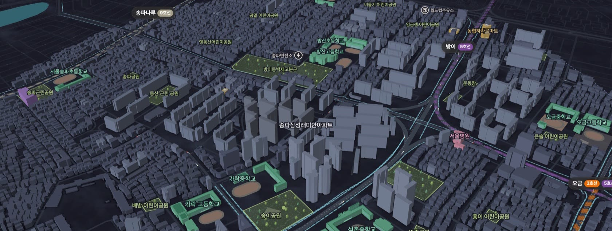
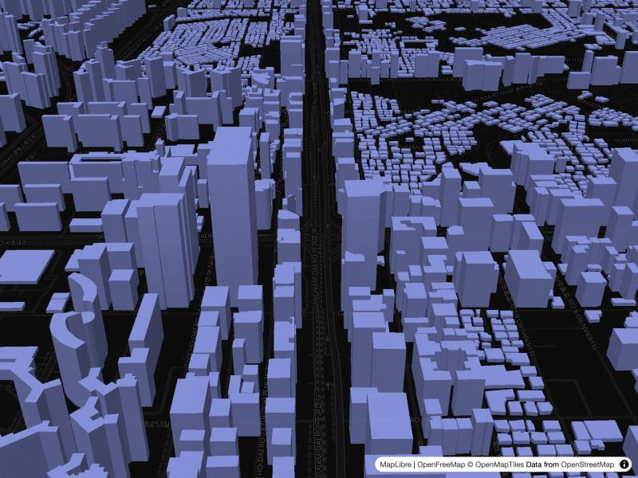

import MapStackDiagram from '@site/src/components/MapStackDiagram';

아파트 주변을 3D로 보여 주는 웹 지도를 혼자 만들었습니다. 10월 31일에 단지 하나로 프로토타입을 시작해 개발 3일차인 11월 2일에 출시했고, 11월 10일까지 시설 모형과 도보 경로, 일조 계산, 성능을 고쳤습니다.

이 글에서 가장 남기고 싶은 건 두 가지입니다. 건물 9,481동이 들어간 지도가 열릴 때마다 두 번씩 만들어지던 문제, 그리고 층수로 추정한 건물 높이를 화면에는 쓰면서 일조 계산에서는 뺀 결정입니다. 앞의 것은 재 보기 전까지 몰랐고, 뒤의 것은 AI 에이전트에게 맡겨 뒀으면 나오지 않았을 판단입니다.

<!-- truncate -->



*완성된 지도의 실제 화면입니다. 서울 송파구의 한 단지 주변 반경 1km를 찍었습니다(2026-11-10).*

<MapStackDiagram />

*구조를 설명하기 위한 그림입니다. 실제 처리 단계와 저장 방식은 단순화했습니다.*

## 무료인 것과 아닌 것

제목의 “유료 SDK 없이”는 범위가 좁습니다. 지도 SDK, 3D 타일, 지오코딩, 지도 데이터 이용에 돈을 내지 않았다는 뜻이고, 외부 3D 모델 파일도 사지 않았습니다.

서버와 저장소, 경로 타일을 만드는 일회성 작업 환경, AI 코딩 도구 비용은 별개로 들었습니다. 공개 API에도 인증키와 호출 제한, 이용 조건이 있습니다. 공짜로 만들었다기보다는 지도 쪽에 고정 라이선스 비용이 없다고 보는 편이 정확합니다.

## 데이터는 어디서 가져왔나

| 역할 | 사용한 것 | 가져오는 값 | 라이선스·조건 |
| --- | --- | --- | --- |
| 주소 → 좌표 | [브이월드](https://www.vworld.kr/) 지오코더 | 도로명 주소의 경위도 | 브이월드 오픈API 약관, 인증키 |
| 건물 외곽선 | 브이월드 WFS | 건물 바닥 모양·층수·건물명 | 같은 약관, 요청당 건수 상한 |
| 건물 높이 보정 | [건축HUB 건축물대장](https://www.data.go.kr/data/15134735/openapi.do) 표제부 API | 건물 높이·지상 층수 | 공공데이터포털 이용 조건, 호출 제한 |
| 생활·기반 시설 | OpenStreetMap ([Geofabrik](https://download.geofabrik.de/asia/south-korea.html) 국내 추출본) | 학교·공원·역·도로·철도·물가·숲 | ODbL, 출처 표기 필수 |
| 도보 경로 | [Valhalla](https://github.com/valhalla/valhalla) | 길을 따른 보행 경로와 시간 | MIT, 공개 서버는 소량만 |
| 배경 지도 | [OpenFreeMap](https://openfreemap.org/) | 벡터 타일 배경 | OSM 출처 표기 |
| 렌더링 | [MapLibre GL JS](https://maplibre.org/) | 입체 건물·선·이름표 | BSD-3-Clause |
| 태양 위치 | [NOAA 계산식](https://gml.noaa.gov/grad/solcalc/) | 날짜·시각별 해 방위와 높이 | 공개 계산식 |

표에 안 나오는 사정이 몇 가지 있습니다.

브이월드 지오코더는 한국 주소를 잘 알아듣지만, 해외 리전의 서버리스 환경에서는 호출이 막히는 경우가 있었습니다. 그래서 국내 API를 부르는 단계만 국내에서 도는 환경에 뒀습니다. WFS는 요청당 건수 상한이 있어서 건물이 많은 도심은 영역을 쪼개 다시 요청합니다.

OSM은 처음에 공개 Overpass API로 질의했는데, 단지가 늘어나니 공용 서버에 미안한 수준이 됐고 응답도 들쭉날쭉했습니다. 지금은 국내 추출본을 주기적으로 받아서 직접 질의합니다. 실패해도 공용 서버로 우회하지 않습니다.

Valhalla 공개 서버는 단지당 한 번, 간격을 두고만 부릅니다. 대량으로 다시 계산할 때는 추출본으로 경로 타일을 만들어 일회성 작업 환경에 띄웠습니다.

## 지도가 두 번 만들어지고 있었다

출시 당일, 언제부턴가 지도가 조금 느려졌다는 느낌이 들었습니다. 건물이나 모형이 많아졌으니 에셋 탓이겠거니 했는데, 재 보니 주차장 모형은 약 10ms였고 저장본을 읽고 파싱하는 데도 8~34ms밖에 안 걸렸습니다.

진짜 문제는 코드에 있었습니다. 도보 경로는 지도 본체보다 늦게 도착합니다. 이걸 받아서 React의 `data` 상태에 합쳤고, 지도를 만드는 effect의 의존성이 `[data]`였습니다. 경로 한 줄이 도착했을 뿐인데 건물 9,481동짜리 지도를 처음부터 다시 만든 겁니다. 기기 저장도 같이 꼬여서 4.8MB 저장이 두 번 일어났고, 경로를 붙인 저장에 ETag가 빠져 있어서 다시 열 때 저장을 건너뛰는 로직은 한 번도 맞은 적이 없었습니다.

고친 방법은 단순합니다. 경로를 별도 상태로 빼고, 경로가 바뀌면 그 레이어에만 `setData`를 했습니다. 지도 본체가 같으면 그것도 건너뜁니다. 저장은 경로까지 붙인 뒤 `ETag|routes` 키로 한 번만 합니다.

같은 단지(건물 약 9,500동)를 맥미니의 헤드리스 Chrome(390×844)에서 잰 결과입니다. CPU 4배 감속은 모바일을 흉내 낸 값이고 실기기 측정은 아닙니다.

| 측정 항목 | 수정 전 | 수정 후 |
| --- | ---: | ---: |
| 처음 열 때 지도 생성 | 2회 | 1회 |
| 처음 열 때 4.8MB 기기 저장 | 2회 | 1회 |
| 조작이 없을 때 메인 스레드 사용량(맥, 10초 뒤) | 239 ms/s | 0 ms/s |
| 지도 `load` 처리(맥, 3회 중앙값) | 1,943ms | 710ms |
| 지도 `load` 처리(CPU 4배 감속, 3회 중앙값) | 7,639ms | 2,709ms |
| 진입부터 장면 준비까지(CPU 4배 감속, 3회 중앙값) | 12.1초 | 5.2초 |

위 두 줄은 재생성 수정(11월 2일), 메인 스레드 줄은 효과 정지(11월 2일), 아래 세 줄은 다음 항목의 탐색 비용을 줄인 작업(11월 5일) 결과입니다. 서로 다른 시점의 전후 비교라 합산해서 읽으면 안 됩니다.

같이 나온 문제들은 이렇습니다.

- 가만히 있어도 차와 열차 효과가 지도를 초당 60번 다시 그렸습니다. 갱신 간격을 50ms에서 200ms로 늘려도 다시 그리는 횟수는 그대로였습니다. 효과마다 갱신이 다른 프레임에 흩어져 도착했기 때문입니다. 간격 조정은 포기하고, 상시 움직임을 `requestAnimationFrame` 루프 하나로 모은 뒤 10초 동안 조작이 없으면 멈추게 했습니다.
- 첫 진입에서는 점마다 건물 전체를 훑는 판정이 많았습니다. 등록부 검사만 건물×점으로 약 190만 번 돌았습니다. 이름 색인과 격자 색인으로 후보를 줄였고, 저장된 지도 47개에서 변경 전후 모형 결과를 바이트 단위로 비교해 같은 것을 확인했습니다.
- MapLibre 페인트 값을 90~200ms마다 바꾸면 기본 300ms 전환이 계속 새로 걸립니다. 전환을 끄니 다시 그리기가 초당 53번에서 32번으로, 프레임 p95가 33ms에서 17ms로 줄었습니다.
- 등장 애니메이션에서 높이 같은 데이터 기반 페인트 값을 매 프레임 바꾸면 원천 타일 전체가 다시 배치됩니다. 프레임 애니메이션에서는 이런 값을 건드리지 않기로 했습니다.
- 역 출구 표식은 지도를 움직일 때마다 `getBoundingClientRect`로 크기를 다시 쟀습니다. 이동 1분에 약 0.9초가 여기에 쓰였고, 이동이 끝난 뒤 묶어서 계산하는 쪽으로 바꿨습니다.

이런 건 원인만 알면 AI 에이전트가 금방 고칩니다. 원인을 모르는 동안에는 AI도 저도 그럴듯한 코드를 계속 쌓고 있었습니다. 지금은 경로를 지도 상태에 합치는 코드와 ETag 없는 저장을 잡는 재발 검사를 테스트로 넣어 뒀습니다. 수정 전 코드에 돌려서 실제로 걸리는 것도 확인했습니다.

## 추정 높이를 일조 계산에서 뺀 이유

건물 높이는 출처가 섞여 있습니다. 건축물대장이나 OSM에 높이가 적힌 건물도 있고, 층수만 있는 건물도 있고, 아무것도 없는 건물도 있습니다. 화면을 채우려면 빈칸에 뭐라도 넣어야 합니다.

| 높이 근거 | 화면 표시 | 일조 계산 |
| --- | --- | --- |
| 건축물대장·OSM에 적힌 직접 높이 | 사용 | 사용 |
| 층수에 일반 층고를 곱한 추정 | 사용 | 제외 |
| 자료가 없어 넣은 기본 높이 | 사용 | 제외 |

지도에서 건물이 2m쯤 틀려도 보는 사람은 모릅니다. “이 집은 동지에 해가 몇 시간 든다”는 숫자는 다릅니다. 앞 건물 높이가 추정값이면 결과도 추정인데, 화면에 찍히는 숫자는 정확해 보입니다.

그래서 높이마다 근거를 같이 저장하고, 일조 계산은 직접 확인된 높이만 읽게 했습니다. 프롬프트에 “추정값은 쓰지 마”라고 적는 것으로는 부족했습니다. 다음 변경에서 AI가 편한 쪽으로 코드를 고치면 조용히 깨지니까요. 근거 필드를 데이터 구조에 넣어 두면 그럴 일이 줄어듭니다.

대가도 있습니다. 높이를 모르는 건물은 그림자를 만들지 않으니 실제보다 햇빛이 많게 나올 수 있습니다. 이 한계는 일조 화면에 그대로 적었습니다.

## HTML 파일 하나로 시작해 보기

키 없이 바로 돌아가는 최소 예제입니다. OpenFreeMap 타일에 들어 있는 OSM 건물을 `fill-extrusion`으로 세웁니다.

```html
<!doctype html>
<html lang="ko">
<head>
  <meta charset="utf-8" />
  <link href="https://unpkg.com/maplibre-gl@5.6.0/dist/maplibre-gl.css" rel="stylesheet" />
  <script src="https://unpkg.com/maplibre-gl@5.6.0/dist/maplibre-gl.js"></script>
  <style>html, body, #map { margin: 0; height: 100%; }</style>
</head>
<body>
  <div id="map"></div>
  <script>
    const map = new maplibregl.Map({
      container: 'map',
      style: 'https://tiles.openfreemap.org/styles/dark',
      center: [127.0276, 37.4979], // 서울 강남역 근처
      zoom: 16, pitch: 60, bearing: -20,
    });
    map.on('load', () => {
      map.addLayer({
        id: 'my-3d-buildings',
        type: 'fill-extrusion',
        source: 'openmaptiles',
        'source-layer': 'building',
        paint: {
          'fill-extrusion-color': '#8b9cf7',
          'fill-extrusion-height': ['coalesce', ['get', 'render_height'], 10],
          'fill-extrusion-base': ['coalesce', ['get', 'render_min_height'], 0],
          'fill-extrusion-opacity': 0.85,
        },
      });
    });
  </script>
</body>
</html>
```



*위 코드를 수정 없이 실행한 화면입니다(2026-11-10). 오른쪽 아래 출처 표기는 OpenFreeMap 스타일이 자동으로 넣습니다.*

여기서 더 나가려면 순서는 대체로 이렇습니다. OSM 건물은 지역에 따라 높이가 비어 있으니, 한국이라면 브이월드 외곽선과 건축물대장 높이로 GeoJSON을 만들어 `addSource`로 올립니다. 관심 건물은 `match` 표현식으로 다른 색을 칠하고, OSM에서 뽑은 학교·공원·역은 이름표와 아이콘 레이어로, Valhalla 응답은 `line` 레이어로 얹습니다.

AI 에이전트에게 맡긴다면 하고 싶은 것보다 하면 안 되는 것을 먼저 적는 편이 결과가 좋았습니다.

> MapLibre GL JS로 특정 좌표 반경 1km의 3D 건물 지도를 만들어 줘. 유료 서비스와 외부 3D 모델 파일은 쓰지 마. 배경은 OpenFreeMap dark 스타일을 쓰고, 건물 높이가 없으면 화면에는 기본값을 쓰되 어떤 건물이 추정값인지 속성으로 구분해 줘. OSM 출처 표기를 넣고, 지도 객체는 한 번만 만들어.

## AI에게 맡긴 일, 맡기지 못한 일

지도 앱 경로를 바꾼 커밋 577개 중 458개(약 79%)에 AI 코딩 에이전트가 작성자나 공동 작성자로 기록돼 있습니다. 코드 양이나 품질을 뜻하는 숫자는 아니지만, 혼자서 이 속도가 나온 이유는 분명히 이쪽입니다.

잘 맡겨진 일은 공식과 조건을 말로 설명할 수 있는 작업이었습니다. 벽마다 `높이 × cot(해 높이)`만큼 밀어낸 그림자 도형, 층별 창 위치에서 해 쪽으로 쏘는 광선 판정, WFS 응답 파싱과 재시도, OSM 태그 분류 같은 것들입니다. 학교 운동장이나 교량 같은 모형도 도형 데이터와 입체 레이어 조합으로 수십 종을 만들었습니다. 지도 관련 테스트 파일은 260개가 넘습니다.

맡기지 못한 일은 앞에 쓴 두 사례와 비슷합니다. 무엇을 쓰지 않을지, 어떤 숫자를 믿을지, 정말 빠른지를 정하는 일이었습니다. 유료 SDK와 모델 다운로드를 금지한 것도 처음에 사람이 건 제약입니다. 안 그러면 에이전트는 가장 쉬운 길로 갑니다. 기피 시설을 지도에 어떻게 표현할지처럼, 보는 사람이 불편할 수 있는 표현의 수위도 직접 정했습니다. 공원 녹색이 안 보인다거나 차량기지 선로가 끊겨 보인다는 것도 화면을 보고서야 알았습니다.

## 공개 데이터를 쓰면서 지킨 것

OSM은 [ODbL](https://www.openstreetmap.org/copyright)이라 지도와 공유 화면에 `© OpenStreetMap 기여자`를 항상 표시합니다. OpenFreeMap도 같은 표기를 요구합니다. Overpass와 Valhalla 공개 서버는 소량 호출에만 쓰고, 반복 질의는 추출본으로 처리합니다.

지도에 시설이 없다고 실제로 없는 건 아니라서 누락 가능성도 안내에 적었습니다. 브이월드와 공공데이터포털 API는 상업적 이용 범위와 호출 제한이 있으니, 비슷한 걸 만든다면 약관부터 확인하시길 권합니다.

## 마치며

위의 HTML 파일을 저장해서 자기 동네 좌표로 바꿔 보면 시작하는 데 5분도 안 걸립니다. 어려워지는 건 그다음, 어떤 값을 믿을지 정하고 실제로 재 보는 단계였습니다. 완성된 결과는 [공개된 지도 목록](https://apt-insights.com/maps/)에서 볼 수 있습니다.

## 참고 자료

- [MapLibre GL JS 문서](https://maplibre.org/maplibre-gl-js/docs/): `fill-extrusion` 등 레이어 명세와 3D 건물 예제.
- [OpenFreeMap](https://openfreemap.org/): 키 없이 쓰는 무료 벡터 타일과 스타일.
- [브이월드 오픈API](https://www.vworld.kr/dev/v4api.do): 지오코더와 WFS 공간정보 레이어 안내.
- [국토교통부 건축HUB 건축물대장정보 서비스](https://www.data.go.kr/data/15134735/openapi.do): 표제부 높이·층수 조회.
- [OpenStreetMap 저작권·라이선스](https://www.openstreetmap.org/copyright): ODbL과 출처 표기 방법.
- [Geofabrik 한국 OSM 추출본](https://download.geofabrik.de/asia/south-korea.html): 주기적으로 갱신되는 국내 OSM 파일.
- [Valhalla](https://github.com/valhalla/valhalla): 오픈소스 경로 엔진.
- [NOAA Solar Calculator](https://gml.noaa.gov/grad/solcalc/): 태양 위치 계산식의 출처.
