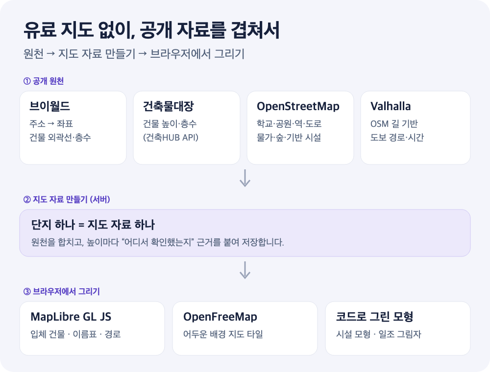

**3D 지도는 오랫동안 “팀이 있어야 만드는 것”이었습니다.** GIS를 아는 사람, 3D 모델을 만드는 디자이너, 렌더링 엔진을 다루는 개발자가 필요했고, 대개 유료 지도 SDK와 3D 타일 비용이 따라왔습니다.

저는 혼자서 [아파트 주변 3D 지도](https://apt-insights.com/maps/)를 만들었습니다. 유료 지도·3D·지오코딩 서비스는 하나도 쓰지 않았고, 외부 3D 모델 파일도 쓰지 않았습니다. 2026년 10월 31일 한 단지로 프로토타입을 만들었고, **사흘 뒤인 11월 2일 서비스에 출시**했습니다. 그 뒤 8일 동안 시설 모형·도보 경로·일조 계산·성능을 다듬었습니다.

가능했던 이유는 세 가지 벽이 동시에 낮아졌기 때문입니다. **데이터는 공개돼 있고, 렌더러는 오픈소스이며, 코드는 AI 에이전트와 함께 씁니다.** 이 글은 그 조합을 재료부터 시작 코드까지 정리합니다. 비슷한 지도를 만들려는 분이 “나도 해 볼 수 있겠다”고 판단할 수 있는 수준까지 공개합니다.

<!-- truncate -->



*구조를 설명하기 위한 그림입니다. 실제 처리 단계와 저장 방식은 단순화했습니다.*

## 요약

- **재료는 전부 무료:** 한국 건물·주소는 브이월드와 건축물대장, 시설과 길은 OpenStreetMap, 도보 경로는 Valhalla, 그리기는 MapLibre GL JS와 OpenFreeMap.
- **모형은 코드로:** 학교·교량·공원 시설 같은 상징 모형을 3D 파일 없이 도형 데이터와 입체 레이어로 그렸습니다.
- **속도는 AI 덕분:** 지도 관련 커밋 577개 가운데 458개(약 79%)에 AI 코딩 에이전트가 작성자 또는 공동 작성자로 기록돼 있습니다.
- **판단은 사람 몫:** 어떤 자료를 믿을지, 무엇을 넣지 않을지, 실제로 빠른지는 끝까지 사람이 정하고 측정했습니다.

## 1. 무엇이 달라졌나: 세 가지 벽

| 예전에 필요했던 것 | 지금 대신 쓴 것 |
| --- | --- |
| 유료 지도 SDK와 3D 타일 | 오픈소스 [MapLibre GL JS](https://maplibre.org/) + 무료 [OpenFreeMap](https://openfreemap.org/) 타일 |
| 건물 3D 데이터 구매 | 행정 공개 자료(브이월드 건물 외곽선 + 건축물대장 높이) |
| 시설 POI 데이터 구매 | [OpenStreetMap](https://www.openstreetmap.org/) 국내 추출본 |
| 3D 디자이너의 모델 파일 | 코드로 만드는 도형 모형 |
| GIS·그래픽스 전문 개발자 | 공식 문서를 읽고 코드를 쓰는 AI 에이전트 + 검증하는 사람 |

마지막 줄이 가장 큰 변화였습니다. 태양 위치 계산식, 벽마다 그림자 다각형을 밀어내는 기하 계산, WFS 응답 파싱, OSM 태그를 시설 분류로 옮기는 반복 작업은 예전이라면 각각 며칠씩 공부해야 했던 일입니다. 지금은 **원하는 결과와 제약을 정확히 설명하고, 나온 코드를 검증하는 일**이 개발자의 주된 작업이 됐습니다.

## 2. 재료: 무엇을 어디에 썼나

| 역할 | 사용한 것 | 무엇을 가져오나 | 라이선스·조건 |
| --- | --- | --- | --- |
| 주소 → 좌표 | [브이월드](https://www.vworld.kr/) 지오코더 | 도로명 주소의 경위도 | 브이월드 오픈API 약관, 인증키 |
| 건물 외곽선 | 브이월드 WFS | 건물 바닥 모양·층수·건물명 | 같은 약관, 요청당 건수 상한 |
| 건물 높이 보정 | [건축HUB 건축물대장](https://www.data.go.kr/data/15134735/openapi.do) 표제부 API | 건물 높이·지상 층수 | 공공데이터포털 이용 조건, 호출 제한 |
| 생활·기반 시설 | OpenStreetMap ([Geofabrik](https://download.geofabrik.de/asia/south-korea.html) 국내 추출본) | 학교·공원·역·도로·철도·물가·숲 | ODbL, 출처 표기 필수 |
| 도보 경로 | [Valhalla](https://github.com/valhalla/valhalla) | 길을 따른 보행 경로와 시간 | MIT, 공개 서버는 소량만 |
| 배경 지도 | OpenFreeMap | 벡터 타일 배경 | 무료, OSM 출처 표기 |
| 렌더링 | MapLibre GL JS | 입체 건물·선·이름표 | BSD-3-Clause |
| 태양 위치 | [NOAA 계산식](https://gml.noaa.gov/grad/solcalc/) | 날짜·시각별 해 방위와 높이 | 공개 계산식 |

각 재료에서 실제로 부딪힌 점은 다음과 같습니다.

- **브이월드 지오코더:** 한국 주소를 가장 잘 이해하는 무료 지오코더입니다. 다만 해외 리전의 서버리스 환경에서는 호출이 막히는 경우가 있어, 국내 API를 부르는 단계는 국내에서 실행되는 환경에 두었습니다.
- **브이월드 WFS:** 지도 SDK의 “보기 좋은 3D 건물”이 아니라 행정 자료의 실제 건물 외곽이라는 점이 장점입니다. 요청당 건수 상한이 있어 건물이 많은 도심은 영역을 나눠 다시 요청합니다.
- **OpenStreetMap:** 처음엔 공개 Overpass API로 질의했지만 단지가 늘자 공용 서버에 부담을 주고 응답도 불안정했습니다. 지금은 국내 추출본을 주기적으로 받아 직접 질의하고, 실패해도 공용 서버로 우회하지 않습니다.
- **Valhalla:** 공개 데모 서버는 단지당 한 번, 간격을 두고만 부릅니다. 대량 재계산이 필요할 때는 추출본으로 경로 타일을 만들어 일회성 작업 환경에서 직접 띄웁니다. 상시 서버가 필요 없습니다.

## 3. 바로 시작해 보기: HTML 파일 하나로 3D 건물 지도

“누구나 만들 수 있다”를 말로만 하지 않기 위해, 키 없이 바로 실행되는 최소 예제를 붙입니다. OpenFreeMap 타일에 들어 있는 OSM 건물을 MapLibre의 `fill-extrusion`으로 세웁니다.

```html
<!doctype html>
<html lang="ko">
<head>
  <meta charset="utf-8" />
  <link href="https://unpkg.com/maplibre-gl@5.6.0/dist/maplibre-gl.css" rel="stylesheet" />
  <script src="https://unpkg.com/maplibre-gl@5.6.0/dist/maplibre-gl.js"></script>
  <style>html, body, #map { margin: 0; height: 100%; }</style>
</head>
<body>
  <div id="map"></div>
  <script>
    const map = new maplibregl.Map({
      container: 'map',
      style: 'https://tiles.openfreemap.org/styles/dark',
      center: [127.0276, 37.4979], // 서울 강남역 근처
      zoom: 16, pitch: 60, bearing: -20,
    });
    map.on('load', () => {
      map.addLayer({
        id: 'my-3d-buildings',
        type: 'fill-extrusion',
        source: 'openmaptiles',
        'source-layer': 'building',
        paint: {
          'fill-extrusion-color': '#8b9cf7',
          'fill-extrusion-height': ['coalesce', ['get', 'render_height'], 10],
          'fill-extrusion-base': ['coalesce', ['get', 'render_min_height'], 0],
          'fill-extrusion-opacity': 0.85,
        },
      });
    });
  </script>
</body>
</html>
```

파일로 저장해 브라우저로 열면 아래처럼 입체 건물이 보입니다. API 키도, 가입도, 빌드 도구도 필요 없습니다.


*위 코드를 수정 없이 실행한 화면입니다(2026-11-10). 오른쪽 아래 출처 표기는 OpenFreeMap 스타일이 자동으로 넣습니다.*

여기서부터가 실제 작업입니다.

1. **건물 원천 바꾸기:** OSM 건물은 지역에 따라 높이가 비어 있습니다. 한국이라면 브이월드 건물 외곽선과 건축물대장 높이로 GeoJSON을 만들어 `addSource`로 올립니다.
2. **내 대상 강조:** 관심 건물만 다른 색으로 칠하는 `match` 표현식을 씁니다.
3. **시설 얹기:** OSM에서 학교·공원·역을 뽑아 이름표와 아이콘 레이어로 올립니다.
4. **경로 그리기:** Valhalla 응답의 경로 선을 `line` 레이어로 그립니다.

AI 에이전트에게는 이렇게 요청하면 시작이 빠릅니다. 요구 사항보다 **제약**을 먼저 적는 것이 핵심입니다.

> MapLibre GL JS로 특정 좌표 반경 1km의 3D 건물 지도를 만들어 줘. 유료 서비스와 외부 3D 모델 파일은 쓰지 마. 배경은 OpenFreeMap dark 스타일을 쓰고, 건물 높이가 없으면 화면에는 기본값을 쓰되 어떤 건물이 추정값인지 속성으로 구분해 줘. OSM 출처 표기를 넣고, 지도 객체는 한 번만 만들어.

## 4. AI가 잘한 일

실제로 시간을 가장 많이 줄여 준 작업들입니다.

- **기하 계산:** 벽마다 `높이 × cot(해 높이)`만큼 밀어낸 그림자 도형, 층별 창 위치에서 해 쪽으로 쏘는 광선 판정 같은 코드는 공식과 조건을 설명하면 빠르게 나왔습니다.
- **코드로 그린 모형:** 교량·학교 운동장·공원 시설 같은 상징 모형을 도형 데이터와 입체 레이어 조합으로 만드는 작업을 수십 종 반복했습니다. 3D 디자이너 없이 가능했던 가장 큰 이유입니다.
- **원천 연결 코드:** WFS 응답 파싱, 영역 분할 재요청, 호출 제한 오류 뒤 재시도, OSM 태그 분류 같은 지루하지만 틀리기 쉬운 코드를 꼼꼼하게 썼습니다.
- **테스트와 측정 도구:** 지도 관련 테스트 파일이 260개가 넘습니다. 첫 진입 성능을 재는 스크립트도 함께 만들었습니다.

## 5. 사람이 끝까지 정해야 했던 일

반대로 AI에게 맡길 수 없었던 일은 대부분 **판단**이었습니다.

### 원칙: 무엇을 쓰지 않을지

“유료 지도·지오코딩 서비스를 쓰지 않는다”, “외부 3D 모델 파일을 쓰지 않는다”는 처음에 사람이 정한 제약입니다. 이 제약이 있어야 AI가 편한 길(유료 SDK, 모델 다운로드)로 빠지지 않습니다. 기피 시설을 어떻게 표현할지처럼 **사용자가 불편하게 느낄 수 있는 표현의 수위**도 사람이 정했습니다.

### 신뢰: 어떤 숫자를 믿을지

건물 높이는 출처가 섞여 있습니다. 그래서 높이마다 근거를 붙이고, 용도에 따라 쓸 수 있는 근거를 나눴습니다.

| 높이 근거 | 화면 표시 | 일조 계산 |
| --- | --- | --- |
| 건축물대장·OSM에 적힌 직접 높이 | 사용 | 사용 |
| 층수에 일반 층고를 곱한 추정 | 사용 | 제외 |
| 자료가 없어 넣은 기본 높이 | 사용 | 제외 |

AI는 빈칸을 그럴듯한 값으로 채우는 데 능숙합니다. 화면을 그리는 데는 그걸로 충분하지만, “이 집에 햇빛이 몇 시간 드는가”처럼 숫자를 말하는 기능에서는 틀린 결론을 만듭니다. **이 경계는 프롬프트가 아니라 데이터 구조로 강제해야** 했습니다. 일조 화면에는 확인된 높이만 썼고, 그 때문에 실제보다 햇빛이 많게 나올 수 있다는 점을 함께 적었습니다.

### 측정: 정말 빠른지

AI가 쓴 코드는 대체로 그럴듯하게 동작합니다. 그런데 도심 단지에서 지도가 무거워졌고, 측정해 보니 원인은 에셋 양이 아니라 **코드 습관**이었습니다.

1. 나중에 도착한 도보 경로 자료 때문에 **지도 전체(건물 수천 동, 레이어 100여 개)를 다시 만들고** 있었습니다. → 늦게 오는 자료는 별도 상태로 두고 해당 레이어만 갱신.
2. 움직이는 효과마다 `requestAnimationFrame` 루프가 따로 돌았습니다. 갱신 간격을 늘려도 다시 그리기가 줄지 않았습니다. → 루프 하나로 모으고, 조작이 없으면 멈춤.
3. 등장 애니메이션에서 높이 같은 **데이터 기반 페인트 값**을 매 프레임 바꿔 원천 타일 전체를 다시 배치하고 있었습니다. → 프레임 애니메이션에서는 바꾸지 않음.
4. 점마다 모든 건물을 훑는 판정이 첫 진입을 수백 ms씩 늘렸습니다. → 공간 색인으로 후보를 줄임.
5. 지도를 움직일 때마다 HTML 마커 크기를 재고 있었습니다. → 이동이 끝난 뒤 묶어서 계산.

각각은 AI에게 고쳐 달라고 하면 금방 고쳐집니다. 하지만 **무엇이 느린지 찾는 일**은 실제 기기에서 재 보기 전까지 아무도 몰랐습니다. 지금은 이 규칙들을 문서와 테스트로 남겨, 다음 변경 때 AI가 같은 실수를 반복하지 않게 합니다.

### 피드백: 사람 눈으로 보기

“공원 녹색이 잘 안 보인다”, “차량기지 선로가 끊겨 보인다” 같은 피드백은 화면을 직접 본 사람에게서 나왔습니다. 여러 시안 중 무엇을 고를지도 사람이 정했습니다. AI는 시안을 빨리 만들어 주지만, 어떤 것이 좋은지는 보는 사람이 정합니다.

## 6. 공개 데이터를 쓸 때의 예의

- **출처 표기:** OSM은 [ODbL](https://www.openstreetmap.org/copyright)이므로 지도와 공유 화면에 `© OpenStreetMap 기여자`를 항상 표시합니다. OpenFreeMap도 같은 표기를 요구합니다.
- **공용 서버 아끼기:** Overpass·Valhalla 공개 서버는 소량 호출에만 쓰고, 반복 질의는 추출본을 받아 직접 처리합니다.
- **없음을 단정하지 않기:** 지도에 시설이 없다고 실제로 없는 것은 아닙니다. 사용자 안내에도 누락 가능성을 적었습니다([3D 지도 보는 법](/blog/apartment-3d-map-guide)).
- **약관 확인:** 브이월드와 공공데이터포털 API는 인증키와 이용 조건이 있습니다. 상업적 이용 범위와 호출 제한을 먼저 확인하세요.

## 맺음말: 이제 질문이 바뀌었다

예전의 질문은 “3D 지도를 만들 수 있는 팀과 예산이 있는가”였습니다. 이제는 **“어떤 공개 데이터를 믿을 수 있고, 무엇을 보여 주지 말아야 하며, 실제로 빠른가”**입니다. 코드는 AI와 함께 빠르게 쓸 수 있지만, 이 세 질문에 답하는 일은 여전히 만드는 사람의 몫입니다.

공개 데이터와 오픈소스는 이미 충분합니다. 위의 HTML 파일 하나에서 시작해 내 동네 건물 하나를 세워 보세요. 완성된 모습은 [공개 3D 지도 목록](https://apt-insights.com/maps/)에서 볼 수 있습니다. 같은 서비스의 데이터를 AI 어시스턴트에 연결한 이야기는 [로그인 없는 공개 MCP 서버를 만들며 정한 7가지 경계](/blog/public-mcp-server-design)에 정리했습니다.

*지도 관련 커밋 수와 AI 기록 비율은 2026-11-10 기준 Git 이력에서 지도 앱 경로를 바꾼 병합 제외 커밋을 센 값입니다. 커밋의 작성자·공동 작성자 기록이며, AI가 작성한 코드 양이나 품질을 뜻하지 않습니다.*

## 참고 자료

- [MapLibre GL JS 문서](https://maplibre.org/maplibre-gl-js/docs/): `fill-extrusion` 등 레이어 명세와 3D 건물 예제.
- [OpenFreeMap](https://openfreemap.org/): 키 없이 쓰는 무료 벡터 타일과 스타일.
- [브이월드 오픈API](https://www.vworld.kr/dev/v4api.do): 지오코더와 WFS 공간정보 레이어 안내.
- [국토교통부 건축HUB 건축물대장정보 서비스](https://www.data.go.kr/data/15134735/openapi.do): 표제부 높이·층수 조회.
- [OpenStreetMap 저작권·라이선스](https://www.openstreetmap.org/copyright): ODbL과 출처 표기 방법.
- [Geofabrik 한국 OSM 추출본](https://download.geofabrik.de/asia/south-korea.html): 주기적으로 갱신되는 국내 OSM 파일.
- [Valhalla](https://github.com/valhalla/valhalla): 오픈소스 경로 엔진.
- [NOAA Solar Calculator](https://gml.noaa.gov/grad/solcalc/): 태양 위치 계산식의 출처.
