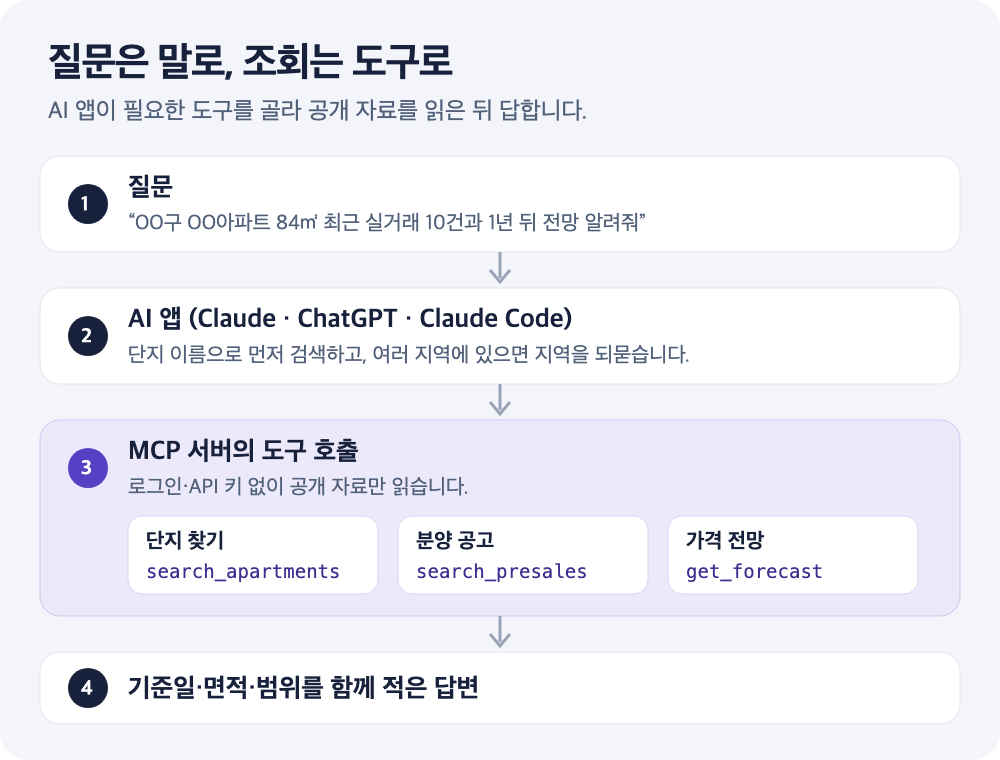

**“이 단지 최근에 얼마에 거래됐어?”를 AI 어시스턴트에게 그대로 물어볼 수 있다면 편하겠지요.** 다만 일반적인 AI 답변은 학습 시점의 기억이나 웹 검색 결과에 기대므로, 면적과 거래일이 섞이거나 오래된 숫자가 나올 수 있습니다.

MCP(Model Context Protocol)는 AI 앱이 외부 데이터를 **정해진 도구를 통해** 읽도록 연결하는 표준입니다. 아파트 인사이트의 공개 MCP 서버를 연결하면 AI가 단지를 검색하고, 저장된 실거래와 분양 공고, 가격 전망을 직접 조회한 뒤 답변합니다. 로그인이나 API 키는 필요하지 않습니다.

<!-- truncate -->



*흐름을 이해하기 위한 설명용 그림입니다. 실제로 어떤 도구를 몇 번 부를지는 AI 앱이 질문에 따라 정합니다.*

## 1. 연결 주소 하나만 기억하면 됩니다

| 항목 | 내용 |
| --- | --- |
| MCP 서버 주소 | `https://mcp.apt-insights.com/mcp` |
| 연결 방식 | Streamable HTTP |
| 인증 | 없음 (로그인·API 키 불필요) |
| 읽을 수 있는 자료 | 공개 단지 정보, 저장된 매매·전세 실거래, 가격 전망, 공개 검증 요약, 청약홈 분양 공고 |
| 읽을 수 없는 자료 | 회원의 관심 단지, 저장 이력, 알림, 개인 설정 |

인증이 없다는 것은 누구나 같은 공개 자료를 본다는 뜻이기도 합니다. 대화 중에 개인 정보를 말하더라도 서버의 도구가 그것을 받아 저장하는 입력은 없습니다.

## 2. 쓰는 앱에 맞춰 연결합니다

### ChatGPT

ChatGPT에는 공식 앱이 있습니다. [AI 어시스턴트 연결 안내](https://apt-insights.com/mcp)의 **‘ChatGPT에서 열기’** 버튼으로 추가하는 방법이 가장 간단합니다.

### Claude (웹·데스크톱·모바일)

1. **설정 → 커넥터 → 사용자 지정 커넥터 추가**를 엽니다.
2. 이름에 `아파트 인사이트`처럼 알아보기 쉬운 이름을, URL에 위 서버 주소를 넣습니다.
3. 인증 항목은 비워 두고 저장합니다.
4. 새 대화에서 커넥터가 켜져 있는지 확인한 뒤 질문합니다.

### Claude Code

터미널에서 한 줄로 추가합니다.

```bash
claude mcp add --transport http apt-insights https://mcp.apt-insights.com/mcp
```

### 그 밖의 MCP 클라이언트

설정 파일을 쓰는 클라이언트라면 다음과 같이 적습니다. 키 이름은 클라이언트마다 조금씩 다를 수 있으니 각 앱의 안내를 함께 확인하세요.

```json
{
  "mcpServers": {
    "apt-insights": { "type": "http", "url": "https://mcp.apt-insights.com/mcp" }
  }
}
```

## 3. 이렇게 물어보면 됩니다

도구 이름을 외울 필요는 없습니다. 평소 말하듯 묻되, **단지 이름·면적·기간** 세 가지를 넣으면 한 번에 원하는 답에 가까워집니다.

| 알고 싶은 것 | 질문 예시 | AI가 주로 쓰는 도구 |
| --- | --- | --- |
| 최근 실거래 | “OO동 OO아파트 84㎡ 최근 매매 10건 보여줘” | `get_recent_transactions` |
| 전세 거래 | “같은 단지 전세 실거래도 따로 보여줘” | `get_recent_transactions` |
| 대표 시세 | “이 단지 대표 시세와 최근 1년 거래 범위는?” | `get_apartment_overview` |
| 가격 전망 | “2027년 11월 기준으로 전망하면?” | `get_forecast` |
| 금리 가정 | “주담대 금리가 4.5%라면 1년 뒤 전망은?” | `get_forecast` |
| 과거 가격 변화 | “이 단지 2024년 가격은 왜 올랐어?” | `get_historical_price_formation` |
| 지역 비교 | “OO구에서 최근 1년 거래가 가장 많은 단지는?” | `rank_region_apartments` |
| 분양 일정 | “이번 달 청약 접수하는 민간 분양 단지 찾아줘” | `search_presales` |
| 분양 조건 | “이 분양 단지 주택형별 최고 분양가와 계약 일정은?” | `get_presale_detail` |
| 청약 경쟁률 | “이 단지 84A 1순위 경쟁률과 당첨 가점은?” | `get_presale_competition` |

단지 이름이 여러 지역에 있으면 AI가 지역을 되묻습니다. 처음부터 시군구를 함께 말하면 한 번에 찾을 수 있습니다. 아직 자료를 모으지 않은 단지라면 AI가 맞는 단지인지 확인한 뒤 **자료 준비**를 요청하고, 몇 분 뒤 다시 조회하도록 안내합니다.

## 4. 분양 단지는 공고 기준으로 묻습니다

분양 도구는 청약홈 공개 자료를 정리한 분양 공고 목록을 읽습니다. 검색 결과는 **청약 예정, 접수 마감, 입주 전** 단계와 공공·민간 구분으로 좁힐 수 있습니다.

분양 답변을 읽을 때는 다음을 구분하세요.

- **분양가:** 주택형별 공식 최고금액입니다. 층이나 옵션에 따른 실제 계약 금액, 주변 시세, 가격 전망이 아닙니다.
- **경쟁률:** 주택형·순위·거주지역별 값입니다. 서로 더하거나 평균 내서 단지 전체 경쟁률처럼 읽지 않습니다.
- **값이 비어 있는 이유:** 접수 전이거나 다른 기관에서 발표하는 경우처럼 자료가 없는 이유가 함께 표시됩니다.
- **정정 공고:** 공고문이 정정됐다면 정정 횟수와 바뀐 내용을 확인한 뒤 원문 공고문과 대조합니다.

일정과 공고문을 읽는 순서는 [청약 일정 가이드](/blog/apartment-presale-schedule-guide)와 [모집공고문 확인법](/blog/apartment-presale-notice-guide)에서 더 자세히 다룹니다.

## 5. 답변을 읽을 때 확인할 네 가지

AI가 정리한 문장보다 **도구가 돌려준 조건**을 먼저 확인하세요.

1. **면적:** 전용면적(㎡)이 질문과 같은지 봅니다. 59㎡와 84㎡의 거래가 섞이면 시세가 왜곡됩니다.
2. **기준일:** 실거래는 마지막 거래일, 전망은 계산 기준일을 함께 봅니다. 신고 기한 때문에 최근 거래가 늦게 반영될 수 있습니다.
3. **범위:** 전망은 대표 예측가 한 숫자와 중앙 50% 예상 범위(P25~P75)로 나옵니다. 실제 가격이 반드시 범위 안에 든다는 보장은 아닙니다. [예상 범위 읽는 법](/blog/apartment-forecast-range-reading)을 참고하세요.
4. **매매와 전세:** 전세 보증금은 매매가가 아닙니다. 두 목록을 따로 받아 비교합니다.

자료가 부족하면 도구는 숫자를 만들지 않고 **분석할 수 없는 이유**를 돌려줍니다. 입주 초기 단지나 거래가 드문 면적에서 이런 답이 나오면, 다른 면적이나 연도를 직접 지정해 다시 물어보세요.

## 자주 묻는 질문

### 요금이 있나요?

연결과 조회에 별도 요금이나 가입은 없습니다. 다만 과도한 호출을 막기 위한 분당 호출 제한이 있어 짧은 시간에 질문을 많이 보내면 잠시 기다리라는 안내가 나올 수 있습니다. AI 앱 자체의 요금제나 커넥터 사용 조건은 각 앱의 정책을 따릅니다.

### AI가 말한 숫자를 그대로 믿어도 되나요?

도구 결과는 국토교통부 실거래가 공개자료와 청약홈 공고를 바탕으로 하지만, AI가 결과를 요약하는 과정에서 면적이나 기간을 바꿔 말할 수 있습니다. 중요한 결정 전에는 [지역별 실거래가 페이지](https://apt-insights.com/apt/)나 공고문 원문에서 같은 조건의 숫자를 다시 확인하세요. 전망은 매수·매도 추천이 아닙니다.

### 웹 검색과 무엇이 다른가요?

웹 검색은 기사나 게시글에 적힌 숫자를 가져오므로 기준일과 면적이 제각각일 수 있습니다. MCP 도구는 같은 단지 ID와 면적 조건으로 저장된 거래를 읽어 오기 때문에, 질문을 바꿔 가며 같은 기준으로 비교하기 쉽습니다.

## 공개 출처

- [아파트 인사이트 AI 어시스턴트 연결 안내](https://apt-insights.com/mcp): 서버 주소, 앱별 연결 방법, 전체 도구 목록.
- [Model Context Protocol 소개](https://modelcontextprotocol.io/): MCP 표준과 클라이언트·서버 구조.
- [국토교통부 실거래가 공개시스템](https://rt.molit.go.kr/): 아파트 매매·전월세 실거래 공개자료.
- [청약홈](https://www.applyhome.co.kr/): 분양 모집공고, 청약 접수와 경쟁률 공개 자료.
