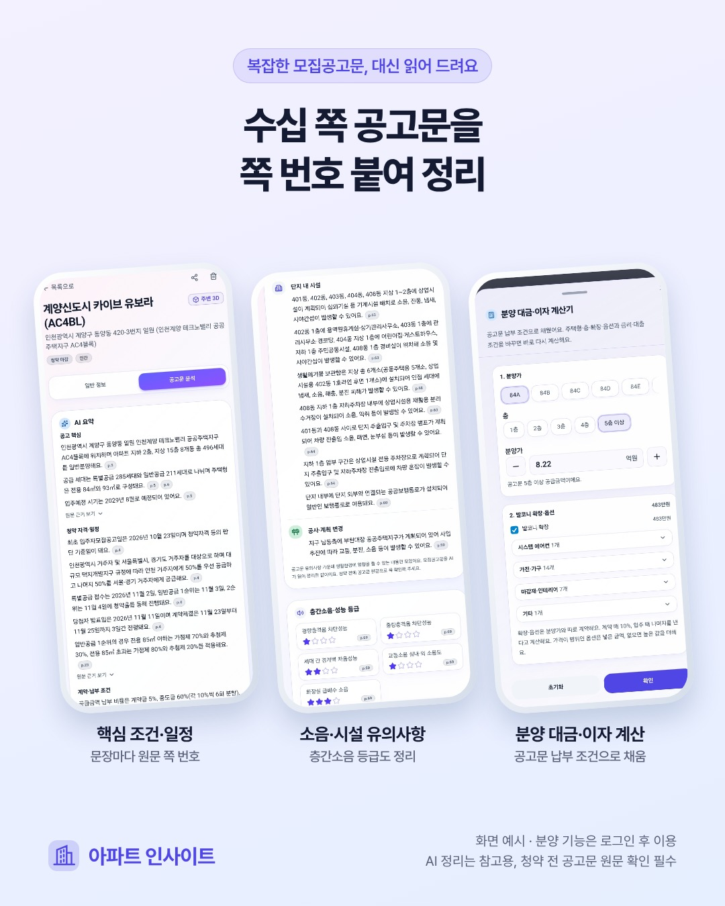

**모집공고문에서 분양가와 청약 날짜만 확인했다면, 계약 전에 읽을 내용이 아직 남아 있습니다.** 납부 조건과 대출 안내, 계약 해제 시 부담, 학교·소음·주변 시설에 관한 설명이 서로 다른 쪽에 흩어져 있기 때문입니다.

긴 공고문을 읽을 때는 관심 항목을 먼저 정하고, 해당 문장과 적용 대상을 함께 확인하는 순서가 도움이 됩니다. 이 글에서는 **정정 내용 → 계약 조건 → 생활환경 → 원문 재확인** 순으로 살펴봅니다.

<!-- truncate -->

## 1. 가장 먼저 공고의 날짜와 정정 여부를 봅니다

[청약홈](https://www.applyhome.co.kr/)에서 단지의 공고를 찾았다면 제목과 공고일, 공급 유형을 확인합니다. 같은 단지에 여러 공급 공고가 있을 수 있으므로 이름만 보고 예전 PDF를 읽지 않도록 주의합니다.

정정 공고라면 무엇이 바뀌었는지부터 봅니다. 날짜 변경인지, 주택형별 금액이나 공급 내용의 변경인지, 안내 문구를 고친 것인지 구분한 뒤 원래 정리해 둔 내용에 반영합니다. 공고문 첫 부분의 정정표만 읽고 끝내지 말고, 수정된 항목이 있는 본문도 찾아보세요.

자료를 저장할 때는 파일과 함께 **공고일·정정 여부·확인 날짜·공식 주소**를 남기면 나중에 비교하기 쉽습니다. 가족에게 전달받은 화면이나 요약만 있는 경우에도 이 네 가지를 먼저 확인하는 편이 좋습니다.

## 2. 계약 조건은 ‘무엇을, 누가, 언제’로 읽습니다

“중도금 대출 안내”, “전매 제한” 같은 제목을 찾은 뒤에는 내게 적용되는 문장 전체를 읽어야 합니다. 기간이나 금액 하나를 떼어 적으면 기준일과 예외 조건을 놓칠 수 있습니다.

| 확인할 항목 | 공고문에서 찾아 적을 내용 |
| --- | --- |
| 공급금액 | 내가 볼 주택형·동·층 구간의 금액과 포함 항목 |
| 계약금·중도금·잔금 | 비율·회차·납부일과 계약금 분납 여부 |
| 중도금 대출 | 알선 여부·이자 부담·대출 불가 시 납부 조건 |
| 전매 제한·실거주 의무 | 적용 여부·기간을 세는 기준·해당 공고의 설명 |
| 계약 해제·연체 | 사유에 따른 부담과 공고에 적힌 처리 조건 |
| 확장·유상옵션 | 별도 계약 여부·선택 가능한 구성·추가 비용 |
| 사전방문·입주 | 예정 시기·별도 통보 사항·잔금 관련 안내 |

예를 들어 공고에 중도금 대출 안내가 있다고 해서 개인의 대출 승인이 확인된 것은 아닙니다. 자금계획을 세울 때는 안내된 조건과 자신의 심사 결과를 구분하고, 금융기관에 확인할 질문을 따로 적어 두세요.

전매 제한이나 실거주 의무도 다른 단지의 기간을 가져오지 않습니다. 해당 공고의 적용 대상과 기준일을 읽고, 해석이 필요한 부분은 사업주체와 공식 안내에서 확인해야 합니다. AI 요약으로 개인의 청약 자격이나 계약의 적법성을 판정할 수는 없습니다.

## 3. 생활환경 특이사항은 동·층·타입까지 확인합니다

공고문에는 조감도나 평면도만으로 알기 어려운 생활환경 안내가 들어갈 수 있습니다. 다음은 특정 단지에 이런 문제가 있다는 뜻이 아니라, **해당 공고에 관련 설명이 있는지 찾아볼 항목**입니다.

- **소음과 주변 시설:** 도로·철도·항공기 소음, 방음시설, 주변 시설 관련 안내
- **학교와 통학:** 학교 배정이나 개교 계획, 임시 배치, 통학 여건에 관한 안내
- **단지 내부:** 쓰레기 보관소·기계실·옥상 설비·커뮤니티 시설의 위치와 이용 조건
- **세대별 조건:** 특정 동·층의 조망, 창이나 피난시설, 평면 구조 관련 설명
- **주변 계획:** 도로·공원·개발 계획의 진행 상황과 변경 가능성에 관한 안내

문장에 특정 동·층·주택형이 적혀 있다면 그 범위를 함께 기록합니다. 한 세대에 관한 안내를 단지 전체의 특징으로 넓히지 않고, 반대로 단지 공통 조건을 내 세대와 무관하다고 넘기지도 않습니다.

공고문에 적힌 주변 시설은 [3D 지도에서 위치 관계를 살펴보는 방법](/blog/apartment-3d-map-guide)과 함께 확인할 수 있습니다. 학교는 가까운 곳과 배정 학교를 구분해야 하고, 지도에 시설이 보이지 않는다는 이유로 실제로 없다고 판단해서는 안 됩니다. 필요한 내용은 현장 방문과 관할 기관 안내로 확인합니다.

## 4. 성능등급은 인증서에 적힌 항목과 함께 읽습니다

공동주택 성능 관련 인증서가 실려 있다면 항목 이름, 등급, 적용 대상을 함께 봅니다. 층간소음에 관한 등급만 찾더라도 경량충격음·중량충격음처럼 서로 다른 항목이 있을 수 있으므로 별 모양이나 숫자 하나만 옮겨 적지 않습니다.

인증서에 표시된 성능 정보와 입주 후 특정 세대에서 느낄 소음은 같은 질문이 아닙니다. 등급을 “소음이 전혀 없다”는 보장으로 해석하지 않고, 검사나 입주 전 안내에 관한 내용이 공고문에 있다면 함께 읽습니다. 이미지가 작아 잘 보이지 않을 때는 원본을 확대해 확인하세요.

## AI 요약은 원문을 찾아 읽는 보조 자료로 씁니다

*2026-11-09 제작 소개 이미지에 담긴 당시 화면 예시입니다. 단지별로 공고문에 포함된 항목과 분석 가능한 자료가 다릅니다.*

아파트 인사이트의 공고문 분석은 확보한 모집공고문을 읽고 핵심 내용과 근거를 정리합니다. 요약 문장 옆의 **쪽 번호와 원문 인용**을 확인하면 긴 문서에서 다시 읽을 위치를 찾는 데 도움이 됩니다.

하지만 쪽 번호가 붙어 있다는 사실만으로 해석과 추출이 모두 정확해지는 것은 아닙니다. 표의 단위를 잘못 읽거나 적용 대상을 놓칠 수 있고, 관련 문장이 다른 쪽에 이어질 수도 있습니다. 금액·제한·계약 조건처럼 결정에 영향을 주는 항목은 원문 앞뒤 문장까지 읽어야 합니다.

## 관심 단지의 공고문을 확인하는 순서

1. [분양 아파트](https://apt-insights.com/presale)에서 단지를 찾고 공급 유형과 공식 공고를 확인합니다.
2. [회원 화면](https://app.apt-insights.com/login)에 로그인해 **분양 아파트** 메뉴에서 관심 단지로 등록합니다. 등록 가능한 수는 등급마다 다릅니다.
3. 자료가 준비되면 상세의 **공고문 분석** 탭을 엽니다. 정정 내용과 계약 전 확인할 조건을 먼저 읽고, 성능등급·특이사항·분양가·옵션을 확인합니다.
4. 중요한 문장의 쪽 번호·인용을 보고 공식 자료의 원문을 엽니다. 금액이나 적용 대상이 맞는지 대조합니다.
5. 확인되지 않은 내용은 질문으로 남겨 사업주체나 해당 기관에 확인합니다. 답변을 받으면 자료의 날짜와 함께 기록합니다.

공고문 원문을 아직 확보하지 못했거나 분석이 준비 중이면 전체 분석을 볼 수 없습니다. 현재 공고문 분석은 PDF 자료가 대상이며, HWP·HWPX 등 지원하지 않는 형식이나 분석 실패 시에는 안내된 상태를 확인해야 합니다. 공유 화면의 일부 분석 카드만 보고 회원용 전체 분석을 모두 확인했다고 생각하지 않는 것도 중요합니다.

## 자주 묻는 질문

### AI가 정리한 내용을 읽으면 모집공고문은 안 봐도 되나요?

요약은 확인할 항목과 위치를 찾는 데 쓰는 보조 자료입니다. 내용의 누락이나 오류가 있을 수 있으므로 신청·계약 전에 해당 공고와 정정 내용을 직접 확인해야 합니다.

### 생활환경 특이사항에 없는 내용은 걱정하지 않아도 되나요?

목록에 없다는 것은 문제가 없다는 확인이 아닙니다. 원문에 없거나 분석에서 빠진 항목일 수 있습니다. 내가 중요하게 생각하는 소음·학교·시설 조건은 별도 질문으로 남겨 확인하세요.

### 전매 제한과 실거주 의무가 표시되면 내 청약 자격도 확인된 건가요?

아닙니다. 공고의 조건을 읽어 보여 주는 것과 개인의 자격을 판정하는 것은 다릅니다. 자격은 해당 공고에서 요구하는 자료와 공식 안내를 기준으로 별도 확인해야 합니다.

## 공식 자료와 함께 읽을 글

- [청약홈](https://www.applyhome.co.kr/): 해당 단지의 모집공고문과 정정 공고를 확인하는 출발점입니다.
- [청약 일정 확인하는 법](/blog/apartment-presale-schedule-guide): 접수·발표·계약·입주 예정의 날짜를 나누어 봅니다.
- [분양 아파트 자금계획](/blog/apartment-presale-payment-plan): 공고문에서 찾은 납부 조건을 금액과 일정으로 옮깁니다.
- [아파트 도보 거리 확인법](/blog/apartment-walking-distance-guide): 학교·역까지의 이동을 볼 때 거리와 배정·통학 조건을 구분합니다.

> 이 글은 2026-11-10 기준의 공고문 확인 방법입니다. AI 분석에는 오류·누락이 있을 수 있으며, 청약 권유·법률 자문·개인별 자격 판정을 대신하지 않습니다. 최종 판단에는 최신 공고문과 관련 기관의 안내를 확인하세요.
