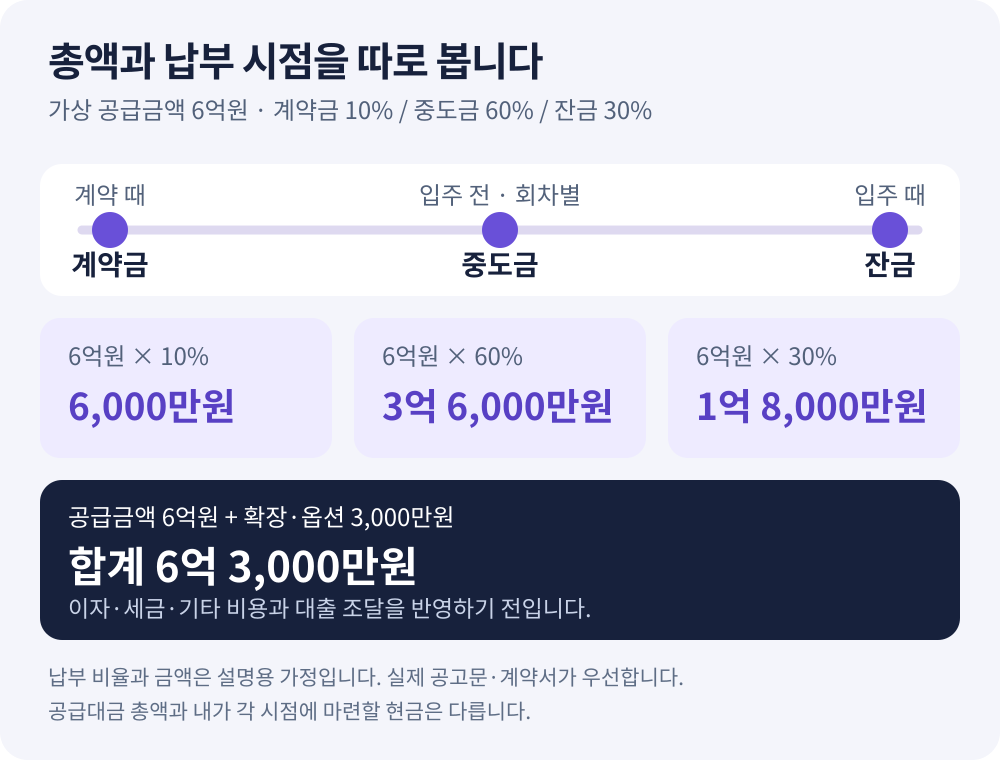

**분양가가 6억 원이라면, 계약할 때부터 6억 원을 준비해야 할까요?** 자금계획에서는 총금액과 납부 시점을 나누어 봐야 합니다. 계약금·중도금·잔금 외에 확장·옵션 비용이 따로 있고, 대출을 이용한다면 실행과 상환 시점도 확인해야 합니다.

이 글에서는 가상의 분양 아파트를 예로 **얼마를 내는지, 언제 내는지, 어떤 자금으로 내는지**를 정리합니다. 아래 금액과 비율은 설명용이며 특정 단지의 조건이나 대출 가능 금액을 뜻하지 않습니다.

<!-- truncate -->

## 1. 공급금액과 별도 비용을 먼저 나눕니다

출발점은 [청약홈](https://www.applyhome.co.kr/)에 공개된 해당 단지의 모집공고문과 주택형별 공급금액입니다. 같은 전용면적이라도 주택형이나 층 구간에 따라 금액이 다를 수 있으므로 내가 볼 조건을 선택합니다. 화면에 표시된 주택형 최고금액을 모든 세대의 계약금액으로 사용하지 않습니다.

계약금·중도금·잔금은 해당 공고·계약의 납부 비율과 회차별 날짜로 나누어 적습니다.

| 구분 | 확인할 자료 | 자금계획에서의 위치 |
| --- | --- | --- |
| 주택 공급금액 | 공고문 주택형·층별 금액 | 계약금·중도금·잔금으로 나누기 |
| 확장·유상옵션 | 별도 계약 금액·납부 조건 | 공급금액과 구분해 추가하기 |
| 대출 이자 | 대출 조건·금리·실행 일정 | 납부 시점에 맞춰 별도로 계산하기 |
| 세금·등기·이사 등 | 내 조건에 맞는 확인·견적 | 위 항목에 포함됐는지 확인하고 별도 준비하기 |

각 항목의 포함 여부를 표시해 두면 빠진 비용과 중복을 찾기 쉽습니다.

## 2. 가상 예시: 공급가 6억 원을 세 단계로 나누기

설명을 위해 **공급가 6억 원, 계약금 10%, 중도금 60%, 잔금 30%**를 가정합니다. 확장·유상옵션은 별도 3,000만 원입니다. 이 비율을 모든 단지의 기준으로 사용해서는 안 됩니다.

| 항목 | 가정한 비율 | 금액 |
| --- | ---: | ---: |
| 계약금 | 공급가의 10% | 6,000만 원 |
| 중도금 합계 | 공급가의 60% | 3억 6,000만 원 |
| 잔금 | 공급가의 30% | 1억 8,000만 원 |
| 주택 공급금액 합계 | 100% | 6억 원 |
| 확장·유상옵션 | 공급가와 별도 | 3,000만 원 |
| 공급금액과 선택 비용의 합계 |  | **6억 3,000만 원** |

**6억 3,000만 원에는 세금·등기·이사 비용과 대출 이자가 포함되지 않았습니다.** 중도금 3억 6,000만 원도 한 번에 낸다는 뜻이 아닙니다. 실제 공고의 회차와 납부일에 맞춰 나누어 적습니다.

*설명용 가상 예시입니다. 확장·옵션 3,000만 원은 별도이며, 세금·대출 이자·등기·이사 비용을 포함하지 않았습니다. 특정 단지의 실제 납부 조건이 아닙니다.*

## 3. 총비용과 ‘입주 때 새로 필요한 돈’은 구분합니다

입주 때 필요한 현금은 **아직 내지 않은 금액과 그때 상환할 대출**을 보고 계산합니다.

위 예시에서 계약금과 중도금을 모두 자기 돈으로 납부했다면, 이미 낸 4억 2,000만 원을 입주 자금에 다시 더하지 않습니다. 입주 시점에는 남은 잔금 1억 8,000만 원, 아직 내지 않은 옵션비와 별도 비용을 확인합니다.

반면 중도금 3억 6,000만 원을 대출로 납부했고 입주 때 전액 상환한다고 가정하면, **잔금 1억 8,000만 원 + 중도금 대출 상환 3억 6,000만 원 = 5억 4,000만 원**의 자금 처리가 필요합니다. 여기에 그때 낼 옵션비·후불 이자·별도 비용을 더하고, 실제 실행 가능한 새 대출이 있다면 그 금액을 구분해 적습니다. 새 대출이 얼마인지 이 예시에서 가정하지 않습니다.

중도금 대출 상환은 공급금액을 한 번 더 지불하는 것이 아닙니다. 앞서 분양 대금을 낼 때 빌린 돈을 갚는 흐름입니다. 따라서 전체 공급금액 6억 원에 중도금 대출 원금 3억 6,000만 원을 다시 더해 주택 가격을 계산하면 중복입니다. 대출 이자는 원금과 별도 비용으로 봅니다.

## 4. 이자가 누구 부담이고 언제 나가는지 확인합니다

중도금 대출 안내를 볼 때는 금리뿐 아니라 이자 부담과 납부 시점을 확인합니다. 공고에 적힌 명칭만 읽고 자신의 대출 승인이나 모든 금융비용 면제를 가정하지 않습니다.

| 계산에서 구분할 조건 | 확인할 질문 |
| --- | --- |
| 무이자 안내 | 어떤 기간·범위의 이자를 누가 부담하나요? |
| 이자후불제 | 어떤 이자가 쌓이고 언제 정산하나요? |
| 이자 직접 납부 | 회차별 대출 실행 뒤 매달 얼마나 필요한가요? |
| 대출 없음·일부만 이용 | 직접 납부할 중도금 회차와 금액은 얼마인가요? |

대출 범위나 금리가 달라졌을 때 필요한 현금도 따로 계산합니다. 실제 승인·한도·금리·만기는 금융기관과 확인해야 합니다.

## 공고문 조건으로 계산해 보는 순서

*2026-11-09 제작 소개 이미지에 담긴 당시 화면 예시입니다. 화면의 단지·금액은 위의 가상 6억 원 예시와 별개이며, 현재 조건과 다를 수 있습니다.*

[아파트 인사이트](https://apt-insights.com/presale)에서 단지를 확인한 뒤 [회원 화면](https://app.apt-insights.com/login)의 **분양 아파트** 메뉴에서 관심 등록합니다. 관심 등록 수는 등급마다 다릅니다. 공고문 PDF가 확보되고 분석에서 납부 조건을 읽을 수 있어야 **분양 대금·이자 계산기**를 이용할 수 있습니다.

1. **주택형·층**을 고르고 공급금액을 원문과 맞춥니다. 내 계약금액을 알고 있다면 그 값을 사용합니다.
2. **확장·옵션**을 선택하고 포함된 금액을 확인합니다. 범위로 나온 옵션 가격은 선택할 구성에 맞춥니다.
3. **계약금·중도금 비율과 회차**, 중도금 대출 조건·금리를 확인합니다.
4. **잔금 대출 조건**을 입력하고 계약 때·입주 전·입주 때 필요한 돈과 월 상환액을 봅니다.
5. 계산에 포함되지 않은 세금·등기·이사 등은 별도 예산에 적고, 실제 계약 일정과 금융기관 조건으로 다시 대조합니다.

계산기는 일부 일정에 가정을 사용합니다. 중도금은 대체로 계약부터 입주 사이에 나누고, 확장·옵션은 계약 때 10%·입주 때 나머지를 낸다고 계산합니다. 실제 공고의 일정과 다르면 결과를 그대로 자금이체 계획으로 사용하지 않습니다.

입주 예정월이 없으면 계약 후 30개월을 가정합니다. 중도금 이자는 회차별 대출 실행월부터 입주월까지 월 단위 단리로 계산하고, 잔금 대출의 월 상환액은 원리금균등 상환을 가정합니다. 실제 대출의 일수 계산이나 상환 방식이 다르면 금융기관의 상환 일정으로 다시 확인하세요.

## 주변 신축 가격과 비교할 때 확인할 범위

공고문 분석의 주변 비교는 **같은 시군구에서 서비스에 등록된 신축 단지**의 유사 면적대 실거래 중위값과 분양가를 나란히 보여 줍니다. 일정 반경 안의 모든 아파트를 조사한 결과가 아니며, 거래가 부족한 단지는 비교에서 빠질 수 있습니다.

현재까지의 실거래와 입주가 남은 분양 주택은 시점·조건이 다릅니다. [국토교통부 실거래가 공개시스템](https://rt.molit.go.kr/)에서 면적·층·계약일을 대조하고, 가격 차이를 확정적인 시세차익으로 읽지 않습니다. 비교 가격이 높아 보여도 내 납부 능력과 대출 조건은 별도로 확인해야 합니다.

## 자주 묻는 질문

### 분양가에 발코니 확장비와 옵션비가 모두 들어 있나요?

공고문과 별도 계약의 포함 범위를 확인해야 합니다. 위 예시는 공급가 6억 원과 확장·옵션 3,000만 원을 분리했습니다. 같은 비용이 공급금액에도 들어 있고 별도 항목에도 들어가지는 않았는지 확인하세요.

### 입주 때 필요한 돈은 잔금 30%만 준비하면 되나요?

공고의 잔금 비율만으로 정할 수 없습니다. 입주 때 상환할 중도금 대출, 후불 이자, 미납 옵션비와 별도 비용을 함께 보고, 이미 낸 금액은 다시 더하지 않습니다.

### 계산기에서 나온 대출 금액만큼 빌릴 수 있나요?

계산 결과는 입력한 조건에 따른 참고치입니다. 실제 대출 승인이나 한도를 보장하지 않습니다. 계약 전에 금융기관에서 내 조건을 확인하고 그 결과로 자금계획을 다시 계산해야 합니다.

## 공식 자료와 함께 읽을 글

- [청약홈](https://www.applyhome.co.kr/): 해당 공고의 주택형별 공급금액과 납부 조건을 확인합니다.
- [주택공급에 관한 규칙 제60조](https://law.go.kr/LSW/lsLawLinkInfo.do?chrClsCd=010202&lsJoLnkSeq=1000407010): 입주금 납부 관련 규정을 확인합니다.
- [청약 일정 확인하는 법](/blog/apartment-presale-schedule-guide): 계산한 금액을 접수·계약·입주 일정에 맞춰 정리합니다.
- [아파트 모집공고문 읽는 법](/blog/apartment-presale-notice-guide): 대출·납부·옵션과 계약 전 확인할 조건을 찾습니다.

> 이 글과 계산 예시는 2026-11-10 기준의 참고용 설명입니다. 대출 승인·세액·수익을 보장하거나 청약을 권유하지 않습니다. 실제 금액과 일정은 최신 모집공고·계약서·금융기관 안내를 확인해야 합니다.
