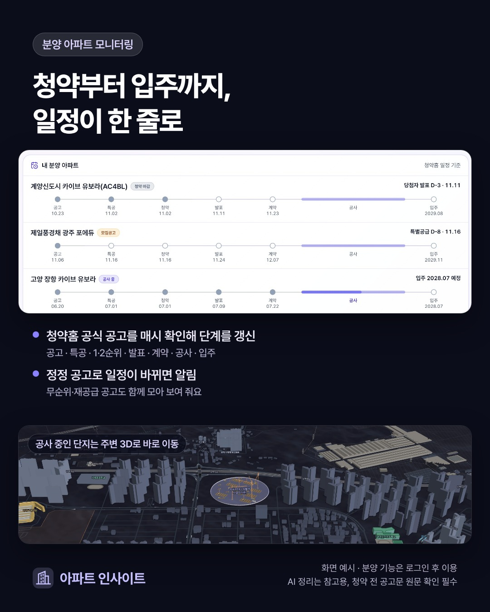

**청약 접수일을 달력에 적었다면 일정 확인은 끝난 걸까요?** 접수 뒤에도 당첨 발표, 서류 제출, 계약과 납부처럼 따로 확인할 일이 남습니다. 같은 단지의 정정 공고가 나오면 처음 적어 둔 날짜가 달라질 수도 있습니다.

청약 일정은 날짜 하나보다 **현재 단계, 다음에 할 일, 다시 확인할 공식 자료**를 묶어 읽는 편이 좋습니다. 처음 공고를 찾았을 때부터 입주 예정월을 확인할 때까지 어떤 순서로 살펴보면 되는지 정리합니다.

<!-- truncate -->

## 1. 단지 이름과 함께 공급 유형·공고를 확인합니다

출발점은 [청약홈](https://www.applyhome.co.kr/)의 해당 모집공고입니다. 단지 이름이 같더라도 일반적인 최초 모집과 무순위·재공급·임의공급은 별도 공고일 수 있습니다. 공고 제목, 공급 유형, 공고일을 함께 적어야 다른 회차의 일정을 가져오는 일을 줄일 수 있습니다.

처음에는 다음 네 가지를 확인하세요.

- 보고 있는 공고의 단지와 공급 위치가 내가 찾는 곳인지
- 공급 유형과 주택형이 무엇인지
- 원래 공고 뒤에 정정 공고나 추가 안내가 있는지
- 접수 날짜뿐 아니라 접수 방법과 마감 시각이 적혀 있는지

모집공고일은 신청을 받기 시작하는 날과 다릅니다. 날짜별 의미와 자격 확인에 쓰는 기준일은 해당 공고문에서 확인해야 합니다. 다른 단지에서 보았던 조건을 그대로 옮겨 적지 않습니다.

## 2. 공고부터 입주까지, 단계별 질문을 나눕니다

아래는 분양 일정을 읽을 때 사용할 수 있는 흐름입니다. **모든 공고에 모든 단계가 있는 것은 아닙니다.** 특별공급이나 순위별 접수가 없는 공고, 이미 입주한 주택을 다시 공급하는 공고는 해당 일정만 확인합니다.

| 단계 | 먼저 확인할 질문 | 함께 기록할 내용 |
| --- | --- | --- |
| 모집공고 | 어떤 주택을 어떤 조건으로 공급하나요? | 공고일·공급 유형·정정 여부·원문 주소 |
| 특별공급 | 해당 접수가 있고, 신청 조건을 확인했나요? | 유형별 접수일·방법·마감 시각 |
| 일반공급 접수 | 내게 해당하는 접수 날짜는 언제인가요? | 순위·지역 등 공고상 구분과 접수 기간 |
| 당첨 발표 | 어디에서 결과와 후속 안내를 보나요? | 발표일·결과 확인 경로·서류 안내 |
| 계약 | 어떤 서류와 금액을 언제 준비하나요? | 계약 기간·장소·계약금 납부 조건 |
| 공사·입주 준비 | 새 안내나 일정 변경이 있나요? | 사전방문·입주 관련 별도 안내 |
| 입주 예정 | 월 단위 예정인가요, 구체적인 기간이 정해졌나요? | 예정월과 추후 통보된 입주 일정 |

특별공급과 일반공급을 한 줄의 “청약일”로 합치면 내가 봐야 할 날짜를 놓치기 쉽습니다. 당첨 발표일과 계약 시작일도 별개입니다. 결과를 확인한 뒤에는 공고문과 사업주체 안내에서 서류 제출·확인 절차가 따로 있는지 살펴보세요.

계약 단계의 돈은 [분양 아파트 자금계획](/blog/apartment-presale-payment-plan)에서 설명한 것처럼 계약금·중도금·잔금으로 나누어 적으면 날짜와 금액을 함께 관리할 수 있습니다.

## 3. ‘현재 단계’와 ‘다음 일정’을 함께 봅니다

한 달 달력은 여러 단지의 접수일을 비교하기에 좋습니다. 한 단지를 계속 지켜볼 때는 공고부터 입주까지 이어지는 단계 표시가 도움이 됩니다. 지금 접수 중인지, 발표를 기다리는지, 계약이 끝났는지를 먼저 확인한 뒤 다음 날짜를 읽을 수 있기 때문입니다.

*2026-11-09 제작 소개 이미지에 담긴 당시 화면 예시입니다. 화면 속 단지와 날짜는 현재 모집공고와 다를 수 있습니다.*

*이미지 속 지도 데이터에는 [© OpenStreetMap 기여자](https://www.openstreetmap.org/copyright)의 자료가 포함됩니다.*

화면에 보이는 D-day는 남은 날짜를 살펴보는 도구입니다. 접수 마감 시각, 신청 방법, 준비 서류까지 모두 대신 확인해 주는 것은 아닙니다. 중요한 일정은 공고문에 있는 시각과 준비할 일을 개인 달력에도 함께 적어 두세요.

입주가 “2028년 3월 예정”처럼 월로만 공개돼 있다면 아직 특정 이삿날을 뜻하지 않습니다. 임대차 종료일이나 이사 예약을 결정하기 전에는 사업주체의 구체적인 입주 안내를 다시 확인해야 합니다.

## 4. 정정 공고가 나오면 바뀐 날짜와 남은 일을 대조합니다

정정 공고를 볼 때는 새 날짜를 적는 데서 끝내지 말고, 이전 날짜와 무엇이 달라졌는지 확인합니다. “당첨 발표일 변경”이라면 결과 확인 날짜를, “계약 기간 변경”이라면 서류와 계약금 준비 계획을 함께 고치는 식입니다.

| 변경을 확인한 항목 | 이어서 확인할 것 |
| --- | --- |
| 접수 기간 | 내가 신청할 공급 유형에도 적용되는지 |
| 당첨 발표일 | 결과 확인 경로와 서류 관련 안내도 달라졌는지 |
| 계약 기간 | 계약금·서류·방문 예약의 기한이 어떻게 안내되는지 |
| 입주 예정월 | 자금과 주거 일정에 영향을 주는 추가 안내가 있는지 |

일정 변경 알림은 이런 재확인을 돕습니다. 다만 **변경 알림과 마감 직전 알림은 다른 기능**입니다. 날짜가 그대로인 공고에서도 접수 마감은 다가오므로, 변경 알림이 오지 않았다는 이유로 확인을 미루면 안 됩니다.

## 관심 분양 단지를 찾아 확인하는 순서

[아파트 인사이트 분양 아파트](https://apt-insights.com/presale)에서 공개된 청약 일정과 단지를 살펴볼 수 있습니다. 관심 단지를 계속 확인하려면 [회원 화면](https://app.apt-insights.com/login)에 로그인한 뒤 다음 순서로 진행합니다.

1. **분양 아파트** 메뉴에서 추가 화면을 열고 단지명이나 지역으로 검색합니다. 청약 단계·공급 구분·공고 시기로 범위를 좁힙니다.
2. 단지를 열어 일반 정보의 **청약 일정**과 공식 자료를 대조합니다. 같은 이름의 다른 공급 공고인지도 확인합니다.
3. 관심 등록이 가능한 등급과 남은 한도를 확인한 뒤 등록합니다. 관심 등록 수는 등급마다 다릅니다.
4. 홈의 **내 분양 아파트**에서 현재 단계와 다음 일정을 봅니다. 정정으로 일정이 바뀌면 알림함과 푸시의 변경 내용을 확인하고 원문을 다시 엽니다.

공식 자료를 수집해 보여 주는 화면이므로 원문 변경과 화면 반영 사이에 시차가 있을 수 있습니다. 푸시는 수신 설정과 발송 시점의 영향을 받으며, 등급 한도를 넘어 잠긴 단지는 변경 알림 대상에서 제외됩니다. 신청·계약 직전의 최종 확인은 청약홈과 사업주체 안내에서 진행하세요.

## 자주 묻는 질문

### 무순위도 특별공급부터 순서대로 진행되나요?

공급 유형마다 일정 구성이 다릅니다. 무순위·재공급·임의공급은 해당 공고의 접수·발표·계약 일정을 따로 읽어야 합니다. 이미 입주한 단지의 공고라면 계약 뒤에 공사 기간이 새로 시작된다고 해석하지 않습니다.

### ‘공사 중’ 표시로 실제 공정률을 알 수 있나요?

이 서비스의 공사 구간이나 진행 표시는 일정으로 계산한 참고 정보입니다. 현장 점검으로 확인한 공정률이 아닙니다. 분양 사업지의 3D 동 배치도 규모를 보여 주는 기호이므로 실제 배치도와 구분해야 합니다.

### 일정 변경 알림을 켜 두면 신청도 자동으로 되나요?

아닙니다. 알림은 바뀐 일정을 확인하는 기능입니다. 청약 신청, 자격 판단, 서류 제출이나 계약을 대신하지 않습니다. 신청은 해당 공고에서 안내하는 공식 절차에 따라 직접 진행해야 합니다.

## 공식 자료와 함께 읽을 글

- [청약홈](https://www.applyhome.co.kr/): 해당 단지의 모집공고·정정 내용·청약 일정과 결과를 확인합니다.
- [한국부동산원 청약홈 안내](https://www.reb.or.kr/reb/na/ntt/selectNttInfo.do?bbsId=1152&nttSn=71202): 청약홈 운영기관의 서비스 안내입니다.
- [아파트 모집공고문 읽는 법](/blog/apartment-presale-notice-guide): 일정 옆에 있는 계약 조건과 생활환경 안내를 살펴봅니다.
- [분양 아파트 자금계획](/blog/apartment-presale-payment-plan): 납부 시점마다 필요한 금액을 나누어 계산합니다.
- [아파트 주변 3D 지도 활용법](/blog/apartment-3d-map-guide): 분양 사업지 주변을 볼 때 확인할 자료와 표시의 한계를 정리합니다.

> 이 글은 2026-11-10 기준의 일정 확인 방법과 서비스 이용 안내입니다. 청약 권유나 개인별 자격 판정이 아니며, 실제 신청·계약에는 해당 모집공고와 정정 공고의 최신 내용을 확인해야 합니다.
