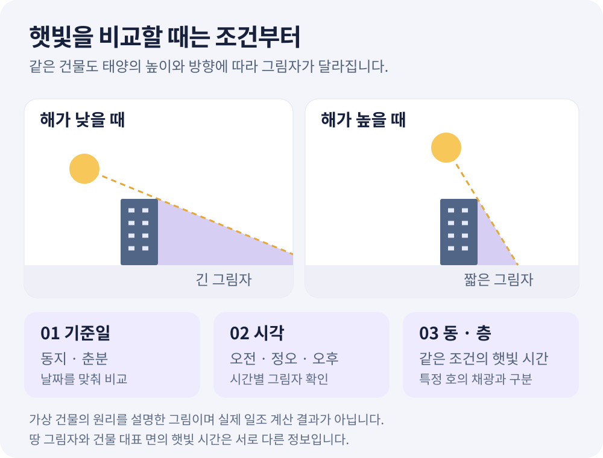

**같은 단지에서 비슷한 방향을 보는 두 동도 햇빛이 들어오는 시간은 같을까요?** 앞에 있는 건물의 위치와 높이, 확인하려는 층에 따라 살펴볼 조건이 달라집니다. 한낮에 방문해 밝았다는 기억만으로 겨울 아침이나 낮은 층의 상황까지 알기는 어렵습니다.

일조 시뮬레이션은 **기준일·시각·동·층을 맞춰 비교하는 도구**로 읽으면 도움이 됩니다. 지도 위 그림자와 카드에 적힌 햇빛 시간이 각각 무엇을 뜻하는지부터 구분해 보겠습니다.

<!-- truncate -->

*비교 방법을 설명하는 개념도입니다. 실제 단지의 건물 배치나 일조 계산 결과를 나타내지 않으며, 특정 층의 햇빛 시간을 제시하지 않습니다.*

## 1. 동지와 춘분 중 같은 기준일을 고릅니다

일조 화면에서는 **동지·춘분**을 선택해 볼 수 있습니다. 기준일을 바꾸면 해의 위치와 그림자가 달라지므로, A동의 동지 화면과 B동의 춘분 화면을 나란히 놓고 어느 동이 더 밝다고 결론 내리면 비교 조건이 맞지 않습니다.

날짜·위치·시각에 따른 태양의 고도와 방위각은 [한국천문연구원의 태양 위치 계산](https://astro.kasi.re.kr/life/pageView/10)에서도 확인할 수 있습니다. 이 자료는 태양의 위치를 확인하는 용도이며, 아파트 주변 건물에 가려지는 시간까지 계산하는 자료는 아닙니다.

처음에는 한 기준일을 고른 뒤 동을 바꿔 보세요. 그다음 같은 동에서 기준일을 바꿉니다. 이렇게 한 가지 조건씩 바꾸면 건물 배치에서 오는 차이와 날짜에 따른 차이를 구분하기 쉽습니다.

정오 한 장면만 보는 것도 충분하지 않습니다. 9시·12시·15시처럼 시각을 바꾸면 그림자가 어느 쪽으로 이동하는지 볼 수 있습니다. **특정 시각의 그림자 모습**은 하루 전체의 햇빛 시간을 대신하지 않습니다.

## 2. 그림자의 시각과 층별 햇빛 합계를 구분합니다

아파트 인사이트의 일조 화면에는 서로 다른 시간 기준이 함께 나옵니다.

| 화면에서 보는 것 | 시간 기준 | 의미 |
| --- | --- | --- |
| 지도 위 땅 그림자 | 선택한 기준일의 9~15시 중 고른 시각 | 그 시각에 건물이 땅에 만드는 그림자 |
| 동 카드의 층별 햇빛 시간 | 선택한 기준일의 8~16시 합계 | 동의 대표 면에서 해당 층에 직사광이 드는 계산 시간 |
| ‘몇 층부터 4시간 이상’ 안내 | 같은 8~16시 구간 | 화면의 계산 조건에서 해당 합계 시간을 만족하는 층 안내 |

예를 들어 설명을 위해 **오전에 2시간, 오후에 2시간 햇빛이 드는 가상 상황**을 생각해 볼 수 있습니다. 합계는 4시간이지만 4시간 동안 연속으로 햇빛이 들었다는 뜻은 아닙니다. 카드의 숫자를 읽을 때도 합계 시간과 연속 시간을 혼동하지 않습니다.

시간 버튼을 12시에서 15시로 바꾸면 그 시각의 그림자가 달라집니다. 동 카드의 햇빛 합계는 선택한 기준일 전체의 계산이므로, 마지막으로 고른 한 시각만 계산한 값으로 읽지 마세요.

## 3. 낮은 층·중간 층·꼭대기 층을 같은 조건으로 봅니다

내 단지 동을 누르면 기본적으로 **3층·가운데 층·꼭대기 층**의 햇빛 시간이 표시됩니다. 층수가 적은 건물은 가능한 층만 나옵니다. 여러 동을 비교할 때는 ‘가운데 층’이라는 말뿐 아니라 실제 몇 층인지도 확인해야 합니다.

층별 숫자를 기록할 때는 아래 항목을 함께 적으면 좋습니다.

- **기준일:** 동지인지 춘분인지.
- **대상:** 어떤 동의 몇 층인지.
- **계산 면:** 카드에 표시된 어느 방향의 면 가운데인지.
- **확인 상태:** 높이와 층수 자료가 있어 계산한 값인지, 계산할 수 없다는 안내인지.

이 계산은 동의 대표 면 가운데를 기준으로 합니다. 한 동 안에서도 호마다 창 방향과 위치가 다를 수 있으므로, 같은 층의 모든 세대에 같은 시간이 들어온다는 뜻은 아닙니다. **햇빛이 직접 닿는 시간과 실내가 얼마나 밝게 느껴지는지도 다른 정보**입니다. 실내 채광에는 실제 창의 크기와 구조 등 지도에 없는 조건이 더해집니다.

관심 호를 확인할 때는 공식 평면도·동호수 배치도로 방향을 대조하고, 가능한 경우 해당 세대에서 직접 살펴보는 순서가 필요합니다. 동 카드의 전용면적이 같아도 타입과 방향이 같다고 판단하지 않습니다.

## 4. 숫자가 나오지 않거나 실제보다 길게 나올 수 있습니다

현재 일조 보기는 **높이가 확인된 건물만** 계산에 사용합니다. 추정 높이와 높이 미확인 건물, 지형·나무는 반영하지 않습니다. 화면에 건물이 보인다고 모두 햇빛을 가리는 계산에 포함되는 것은 아닙니다.

예를 들어 실제로는 앞 건물이 햇빛을 가리는데 그 건물의 높이를 확인하지 못했다면, 계산에서는 햇빛 시간이 실제보다 길게 나올 수 있습니다. 주변 건물들이 화면에 잘 그려져 있다는 이유만으로 일조 자료도 완전하다고 생각하지 않는 것이 좋습니다.

반대로 선택한 동의 층수나 확인된 높이가 없으면 햇빛 시간을 계산하지 못했다는 안내가 나옵니다. **값이 없다는 것은 햇빛이 0시간이라는 뜻이 아닙니다.** 그림자도 땅에만 표현하므로 다른 건물의 외벽이나 지붕에 생기는 그림자를 화면 그대로 읽어서는 안 됩니다.

## 5. 실제 서비스에서 비교하는 순서

1. [회원 화면에 로그인](https://app.apt-insights.com/login)한 뒤 관심 단지 상세의 **‘주변 3D’**를 엽니다.
2. 지도 자료가 준비되면 **‘일조’** 보기를 선택합니다.
3. **동지 또는 춘분**을 고르고 9~15시의 시각을 바꿔 그림자 방향을 살펴봅니다. 시간 재생 기능으로 변화도 볼 수 있습니다.
4. 관심 동을 눌러 카드에 표시된 층별 햇빛 합계와 계산 면의 방향을 확인합니다.
5. 같은 기준일을 유지한 채 다른 동을 확인한 뒤, 기준일을 바꿔 다시 비교합니다.

동 카드를 열면 지도를 덜 가리도록 시간 버튼과 일부 안내가 접힐 수 있습니다. 시각별 그림자를 다시 보려면 동 카드를 닫고 시간 버튼을 조작하세요. 화면의 ‘실제 시각’이나 ‘밤’을 보고 있었다면 비교할 때는 동지·춘분 기준일을 다시 선택합니다.

[공개 3D 지도 목록](https://apt-insights.com/maps/)에서는 주변 건물과 시설을 먼저 둘러볼 수 있습니다. 다만 공개 공유 화면에는 회원의 보기 모드 전환이 없어 **일조 계산을 직접 조작할 수 없습니다.** 내 단지의 일조는 회원 지도에서 확인합니다. 건물 자료가 부족해 일조 보기가 비활성화됐다면 자료 준비 안내를 따라야 합니다.

## 자주 묻는 질문

### 높은 층이면 언제나 햇빛 시간이 더 긴가요?

동과 주변 건물의 배치, 대표 면의 방향, 기준일이 함께 작용합니다. 우선 같은 동·같은 기준일에서 표시된 층끼리 비교하세요. 다른 동의 꼭대기 층끼리 비교할 때도 실제 층수와 계산 면을 확인해야 합니다.

### ‘4시간 이상’이면 일조권을 충족한다는 뜻인가요?

이 화면의 계산 안내만으로 판정할 수 없습니다. 대표 면을 대상으로 제한된 건물 자료를 사용한 참고 계산이며, 특정 세대의 실제 일조를 측정하거나 법적 기준을 판정한 결과가 아닙니다.

### 햇빛 시간이 길게 나오면 방문 확인은 생략해도 되나요?

실제 관심 호의 창 방향·위치와 주변 장애물을 지도만으로 모두 알 수는 없습니다. 시뮬레이션에서 궁금한 시각과 조건을 정한 뒤, 해당 세대와 주변 환경을 확인하는 데 활용하세요.

## 공개 출처와 이어서 볼 글

- [아파트 인사이트 아파트 주변 3D 지도](https://apt-insights.com/maps/): 공개 지도와 이용 안내.
- [한국천문연구원 태양 고도·방위각 계산](https://astro.kasi.re.kr/life/pageView/10): 날짜·위치·시각별 태양 위치 확인.
- [OpenStreetMap 저작권·데이터 출처 안내](https://www.openstreetmap.org/copyright): 지도에 활용되는 공개 공간정보의 출처와 이용 조건.
- [아파트 3D 지도 보는 법](/blog/apartment-3d-map-guide): 동 배치와 주변 건물, 전용면적 자료를 읽는 방법.
- [아파트 도보 생활권 확인법](/blog/apartment-walking-distance-guide): 역·학교까지의 거리와 보행 추정 시간을 구분하는 방법.
