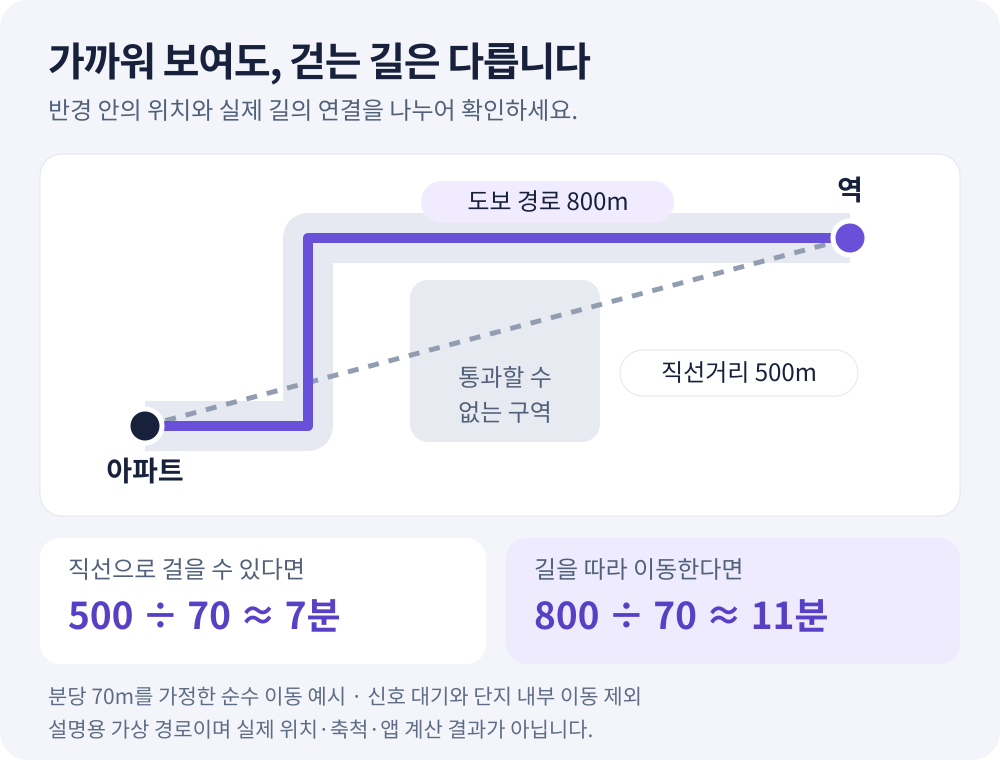

**“역까지 500m”라고 적혀 있으면 걸어서 몇 분이라고 생각하시나요?** 분당 70m를 걷는다고 가정하면 500m를 이동하는 데 약 7분이 걸립니다. 하지만 지도에 적힌 500m가 직선거리라면 실제로 걸어야 할 길은 더 길 수 있습니다.

도보 생활권을 비교할 때는 **어디에서 출발해, 어떤 길로, 어디까지 가는지**를 먼저 맞춰야 합니다. 같은 역과 가까운 아파트라도 출입구와 건널목 위치에 따라 이용하는 동선은 달라집니다.

<!-- truncate -->

*직선거리와 보행 경로의 차이를 설명한 가상 도식입니다. 실제 단지·역의 위치나 앱에서 계산한 결과가 아닙니다.*

## 1. 직선거리·도보 경로·도보 범위는 각각 다른 정보입니다

지도에 가까이 찍힌 시설을 찾는 것과 그곳까지 걸어가는 방법을 확인하는 것은 구분해야 합니다.

| 정보 | 답하는 질문 | 읽을 때 확인할 것 |
| --- | --- | --- |
| 직선거리 | 두 지점이 공간적으로 얼마나 가까운가? | 출발점과 도착점, 그 사이의 장애물 |
| 도보 경로 | 길을 따라 어떻게 걸어가는가? | 이동 거리, 건널목·출입구 위치 |
| 도보 예상 시간 | 그 경로를 걷는 데 얼마나 걸리는가? | 추정 조건, 신호 대기와 내부 이동 포함 여부 |
| 도보 범위 | 일정 시간 안에 어느 방향까지 갈 수 있는가? | 계산 출발점, 길의 연결과 출입 제한 |

원으로 그린 반경은 모든 방향으로 같은 거리입니다. 길을 따라 계산한 도보 범위는 도로망과 연결된 길에 따라 모양이 달라질 수 있습니다. 큰 도로나 철도, 하천을 건너야 하는 방향에서는 건널 수 있는 지점까지 돌아가는 길도 살펴봐야 합니다.

## 2. 직선 500m, 걷는 길 800m인 가상의 사례

아파트 대표점과 역 사이의 직선거리가 500m지만 건널목을 지나가는 보행 경로는 800m인 상황을 가정해 보겠습니다.

| 비교 항목 | 거리 | 분당 70m로 이동한다고 가정한 시간 |
| --- | ---: | ---: |
| 두 지점을 직선으로 연결 | 500m | 약 7분 |
| 걸을 수 있는 길을 따라 이동 | 800m | 약 11분 |

**분당 70m는 설명을 위한 가정이며 서비스의 계산 속도나 실제 측정값이 아닙니다.** 표의 시간에는 멈춰 서서 기다리는 시간이 없습니다. 집에서 단지 밖으로 나오는 시간, 신호 대기, 역 출입구에서 개찰구나 승강장까지의 이동을 더하면 체감 시간은 달라집니다.

따라서 두 아파트를 비교할 때 한쪽은 ‘단지 대표점부터 역 위치까지’, 다른 쪽은 ‘내 집 현관부터 승강장까지’ 재면 조건이 맞지 않습니다. 우선 같은 기준의 지도 경로끼리 비교하고, 실제 출퇴근에 필요한 구간을 따로 기록하세요.

## 3. 5·10·15분 범위에 생활 목적을 대입합니다

도보 범위는 “여기까지 갈 수 있다”는 경계를 살피는 데 도움이 됩니다. 여기에 **내가 얼마나 자주 가는 곳인지**를 더하면 비교 기준이 선명해집니다.

- **매일 가는 곳:** 이용할 노선의 역, 통학할 학교처럼 반복되는 경로를 먼저 봅니다.
- **자주 가는 곳:** 공원·장보기 장소·도서관 등 평일이나 주말에 이용할 시설을 살펴봅니다.
- **방향이 같은 곳:** 귀가길에 장보기를 할 수 있는지처럼 여러 목적지를 함께 생각합니다.

예를 들어 역이 가까워도 자주 쓰는 노선의 승강장까지 이동이 길 수 있습니다. 공원이 도보 범위 안에 보여도 입구가 반대쪽이라면 실제 접근이 달라질 수 있습니다. 범위 안에 시설 점이 있다는 사실을 확인한 뒤, 필요한 출입구와 연결되는 길을 확인하는 순서가 좋습니다.

언덕 안내가 보이면 오르는 방향과 높이 차이도 살펴보세요. 다만 지형 자료를 이용한 추정이므로 작은 경사나 육교·계단까지 모두 설명한다고 볼 수는 없습니다. 현장에서는 평소 이동할 시간대와 신발, 짐의 유무를 고려해 직접 걸어 보는 것이 도움이 됩니다.

## 4. 가까운 학교와 배정 학교를 구분합니다

지도에서 가장 가까운 초등학교가 반드시 배정 학교는 아닙니다. 아파트 인사이트에서는 학구 자료와 위치가 확인된 배정 초등학교를 별도로 표시하고, 배정 학교의 도보 경로가 준비되면 그 경로에 **‘배정’** 표시를 붙입니다.

반대로 가까운 학교의 경로만 표시됐다면 이를 배정 학교로 받아들이지 않습니다. 배정 정보나 경로를 확인하지 못한 상태일 수도 있습니다. 실제 취학을 준비할 때는 **해당 주소·동과 적용 학년도의 통학구역**을 관할 교육지원청 안내에서 확인해야 합니다.

통학 동선에서는 거리뿐 아니라 건널목, 보도 연결, 출입구, 실제 등하교 시간대의 차량 흐름을 별도로 살펴보세요. 도보 시간은 이 모든 조건을 평가한 통학 안전 점수가 아닙니다.

## 5. 실제 서비스에서 도보 생활권 확인하기

지도 화면이 처음이라면 [공개 3D 지도 목록](https://apt-insights.com/maps/)에서 이미 공유된 지도와 제공되는 도보 경로를 먼저 살펴볼 수 있습니다. 내 관심 단지의 도보 범위와 학구 정보를 확인하려면 회원 화면으로 들어갑니다.

1. [로그인](https://app.apt-insights.com/login) 후 단지 상세에서 **‘주변 3D’**를 엽니다.
2. **‘시설’** 보기에서 역·학교의 위치와 단지 대표점 기준 직선거리를 확인합니다.
3. **‘걸어서 가까운 곳’**에서 제공되는 역·학교 경로를 골라 거리와 예상 시간을 봅니다.
4. **‘도보 범위’**로 전환해 5·10·15분 영역을 살펴봅니다.
5. 학교는 **‘배정’** 여부를 구분하고, 실제 이용할 출입구와 현장 확인 항목을 적습니다.

도보 경로는 지도에 등록된 길을 바탕으로 추정하며, 안내에 신호 대기와 단지 안 동선이 빠져 있다고 표시됩니다. 도보 범위도 단지 대표점 기준이고 출입 제한 등에 따라 실제와 달라질 수 있습니다. 계산이나 자료를 불러오지 못했다면 해당 영역에 갈 수 없다는 뜻으로 해석하지 않습니다.

공유받은 지도에서는 이미 준비된 도보 경로를 볼 수 있지만, 회원의 **‘도보 범위’ 모드와 학구 정보는 제공되지 않습니다.** 원하는 탭이 보이지 않는다면 공개 공유 화면인지부터 확인해 보세요.

## 자주 묻는 질문

### 도보 10분 범위 안에 있으면 언제나 10분 안에 갈 수 있나요?

보행 추정 범위입니다. 실제 출발 위치, 걷는 속도, 신호와 출입 제한에 따라 달라집니다. 특히 큰 단지는 대표점에서의 경로와 내가 이용할 동·출입구에서의 경로를 구분해 보세요.

### 가장 가까운 역 하나만 확인하면 되나요?

자주 이용할 노선과 목적지를 기준으로 비교하는 것이 좋습니다. 화면에 제공되는 다른 노선의 역이나 추가 경로도 살펴보고, 실제 출입구와 역 내부 이동은 별도로 확인하세요. 단순한 직선거리 순위만으로 출퇴근 편의를 정하기는 어렵습니다.

### 학교의 ‘배정’ 표시만 보고 이사 계획을 세워도 되나요?

지도는 확인한 학구 자료를 보여 주는 참고 수단입니다. 주소·동과 적용 시기에 맞는 통학구역은 관할 교육지원청의 공식 안내로 대조하세요. 가까운 학교만 보이거나 배정 정보가 없을 때 임의로 배정을 추정하지 않습니다.

## 공개 출처와 이어서 볼 글

- [아파트 인사이트 아파트 주변 3D 지도](https://apt-insights.com/maps/): 지도 이용 안내와 공개 공유 지도.
- [OpenStreetMap 저작권·데이터 출처 안내](https://www.openstreetmap.org/copyright): 지도에 활용되는 공개 공간정보의 출처와 이용 조건.
- [아파트 3D 지도 보는 법](/blog/apartment-3d-map-guide): 동 배치·주변 시설·전용면적 구성을 읽는 순서.
- [동·층별 일조 시뮬레이션 읽는 법](/blog/apartment-sunlight-simulation-guide): 이동 동선 다음으로 살펴볼 햇빛 조건.
