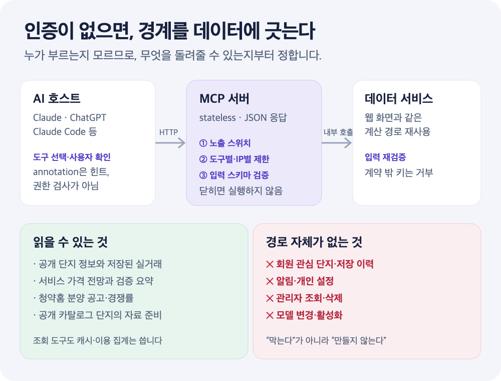

**로그인 없이 누구나 연결할 수 있는 MCP 서버를 만든다면, 무엇으로 권한을 지켜야 할까요?**

아파트 실거래와 가격 전망을 Claude·ChatGPT에서 묻게 해 주는 공개 MCP 서버를 2026년 10월 9일 처음 배포했습니다. 도구 18개로 시작해 지금은 23개(조회 22개, 자료 준비 1개)이고, ChatGPT에는 [공식 플러그인](https://chatgpt.com/plugins/plugin_asdk_app_6ac905007c508191837b1be3724af6d3)으로 공개됐습니다. 한 달 동안 가장 오래 고민한 것은 기능이 아니라 **경계**였습니다. 사용자 인증이 없으니 “이 사람이 볼 수 있는가”를 묻는 기존 권한 모델을 쓸 수 없기 때문입니다.

이 글은 그 과정에서 정한 일곱 가지 경계와, 실제로 부딪힌 문제를 정리합니다. 부동산 도메인과 무관하게, 공개 데이터를 AI에 연결하려는 분께 같은 질문이 반복될 것입니다.

<!-- truncate -->



*구조를 설명하기 위한 그림입니다. 실제 배포 구성의 이름과 설정값은 생략했습니다.*

## 요약

| 질문 | 이 서버의 답 |
| --- | --- |
| 인증 없이 무엇을 돌려주는가? | 비로그인 공유 화면에 이미 공개된 값만 |
| 위험한 도구는 어떻게 막는가? | 막지 않고, 만들지 않는다 |
| annotation·CORS는 무엇인가? | 호스트·브라우저용 힌트. 권한 검사가 아님 |
| 사용자 확인은 누가 보장하는가? | 호스트에 안내하고, 서버는 범위·동시성으로 방어 |
| 실패는 어떻게 알리는가? | 고정된 사유 코드 + 다음 행동에 필요한 값 |
| 숫자가 없을 때는? | 만들지 않고 이유를 돌려준다 |
| 호출 제한의 의미는? | 과부하 방지. 개인별 쿼터가 아님 |

## 먼저 직접 호출해 보기

서버는 stateless Streamable HTTP라 세션 없이 바로 도구 목록을 받을 수 있습니다.

```bash
curl -s https://mcp.apt-insights.com/mcp \
  -H 'Content-Type: application/json' \
  -H 'Accept: application/json, text/event-stream' \
  -d '{"jsonrpc":"2.0","id":1,"method":"tools/list"}'
```

응답의 도구 하나는 이렇게 생겼습니다(일부 생략).

```json
{
  "name": "get_historical_price_formation",
  "title": "과거 가격 형성 분석",
  "annotations": {
    "title": "과거 가격 형성 분석",
    "readOnlyHint": true,
    "destructiveHint": false,
    "idempotentHint": true,
    "openWorldHint": false
  }
}
```

AI 앱에서 쓰려면 ChatGPT는 [공식 플러그인](https://chatgpt.com/plugins/plugin_asdk_app_6ac905007c508191837b1be3724af6d3)을 추가하고, Claude Code는 한 줄이면 됩니다.

```bash
claude mcp add --transport http apt-insights https://mcp.apt-insights.com/mcp
```

## 1. 권한은 “누가”가 아니라 “무엇을”로 정한다

인증이 없으면 호출자를 식별할 수 없습니다. 그래서 질문을 바꿨습니다. **이 서버가 돌려줄 수 있는 데이터는 무엇인가?**

- 읽기 범위를 공개 단지 정보, 저장된 실거래, 서비스 전망, 공개 검증 요약, 청약홈 분양 공고로 한정했습니다.
- 회원 관심 단지·저장 이력·알림·개인 설정, 관리자 조회·삭제·모델 변경에 해당하는 도구는 **아예 만들지 않았습니다.** 막는 코드보다 없는 경로가 안전합니다.
- 도구가 받는 단지 ID는 공개 식별자입니다. ID를 안다고 권한이 생기는 구조가 아니므로, ID를 비밀 토큰이나 동의 증빙으로 취급하지 않습니다.

이 원칙 덕분에 새 도구를 추가할 때의 검토 질문도 하나로 줄었습니다. **“비로그인 공유 화면에 이미 보이는 값인가?”** 11월에 분양 도구 3개를 추가할 때도 공고문 분석 중 공유 화면에 공개된 항목(정정 내용, 성능 등급, 특이사항)만 넣고, 회원 기능인 대금 계산기·주변 시세 비교는 뺐습니다.

## 2. annotation은 힌트이지 권한 검사가 아니다

MCP 도구에는 `readOnlyHint`, `destructiveHint`, `idempotentHint`, `openWorldHint`를 붙일 수 있습니다. 조회 도구 22개는 읽기 전용·비파괴·멱등으로, 자료 준비 도구 하나만 `readOnlyHint: false`로 표시했습니다. [MCP 명세](https://modelcontextprotocol.io/docs/concepts/tools)도 annotation을 신뢰할 수 없는 힌트로 다루라고 말합니다.

흔히 생기는 착각이 두 가지 있습니다.

1. **annotation이 실행을 막아 준다는 착각.** annotation은 호스트가 확인 창을 띄울지 판단하는 재료입니다. 서버는 annotation과 무관하게 같은 검증을 해야 합니다.
2. **읽기 전용이면 아무것도 쓰지 않는다는 착각.** 조회 도구도 결과 캐시와 이용 집계를 씁니다. “사용자 데이터를 바꾸지 않는다”와 “저장소에 아무것도 쓰지 않는다”는 다른 약속이라 문서에 둘을 나눠 적었습니다.

`idempotentHint: true`도 같은 단지 준비 요청을 반복해도 결과가 같다는 뜻이지, 동시에 들어온 요청 전체에 대해 단 한 번만 실행된다는 강한 보장은 아닙니다.

**디렉터리 심사에서 배운 것:** 호스트마다 도구 표시명을 읽는 위치가 다릅니다. 최상위 `title`만 채우면 어떤 화면에서는 이름이 빠졌습니다. 지금은 최상위 `title`과 `annotations.title`에 같은 값을 넣고, 두 값의 일치를 테스트로 확인합니다. 위 응답에 같은 이름이 두 번 보이는 이유입니다.

## 3. “사용자 확인 후 실행”은 서버가 보장할 수 없다

자료 준비 도구는 아직 수집하지 않은 단지의 실거래 수집과 입지 분석을 시작합니다. 도구 설명과 서버 instructions에 **사용자가 맞는 단지라고 확인한 뒤 호출하라**고 적었습니다.

하지만 입력에 일회용 승인 토큰이나 동의 기록이 없으므로, 이 확인은 AI 호스트와 대화 흐름에 맡긴 안내입니다. “서버가 확인을 검증한다”고 설명하면 과장입니다. 대신 서버는 이렇게 방어합니다.

- 공개 카탈로그에 있는 단지만 준비할 수 있습니다.
- 동시 작업 여유가 없으면 `busy`로 거절합니다.
- 기존 자료와 식별 관계가 어긋나면 `identity_conflict`를 돌려주고, 자동 재시도로 해결하지 않도록 안내합니다.

**보장할 수 있는 것과 안내만 할 수 있는 것을 문서에서 구분하는 일**이 공개 서버 운영의 절반이라고 느꼈습니다. 보안 점검도 이 구분부터 시작했습니다.

## 4. 업무 실패와 프로토콜 오류를 섞지 않는다

| 구분 | 예 | 응답 모양 |
| --- | --- | --- |
| 프로토콜 오류 | 잘못된 JSON-RPC, 모르는 도구, 스키마 검증 실패 | SDK의 표준 오류 |
| 업무 실패 | 수집 중, 거래 부족, 허용 범위 밖의 목표 월 | `isError: true` + `{ reason, message, detail? }` |

업무 실패의 `reason`은 `preparing`, `no_trades`, `size_unavailable`, `rate_limited` 등 열한 가지로 고정했고, `detail`에는 **다음 호출을 만드는 데 필요한 값만** 담습니다.

```json
{
  "reason": "preparing",
  "message": "실거래 수집과 입지 분석이 진행 중입니다. 잠시 뒤 다시 조회해 주세요.",
  "detail": { "apartmentId": "APARTMENT_ID_FROM_SEARCH", "estimatedWaitSeconds": 180 }
}
```

AI는 `message`를 읽고 사용자에게 설명하고, `detail`로 다음 호출을 만듭니다. 도구 정의는 공식 TypeScript SDK로 대략 이런 모양입니다(설명용으로 단순화한 예).

```ts
server.registerTool(
  'get_recent_transactions',
  {
    title: '최근 실거래',
    description: '저장된 매매·전세 실거래를 구분해 최신순으로 제공합니다. 전세 보증금을 매매가로 표현하지 마세요.',
    inputSchema: { apartmentId: z.string().regex(/^[A-Za-z0-9_-]{1,64}$/), sizeM2: z.number().positive().max(1000).optional() },
    annotations: { title: '최근 실거래', readOnlyHint: true, destructiveHint: false, idempotentHint: true, openWorldHint: false },
  },
  async (input) => {
    const result = await data.recentTransactions(input);
    if (!result.ok) {
      return { isError: true, structuredContent: result.failure, content: [{ type: 'text', text: result.failure.message }] };
    }
    return { structuredContent: result.value, content: [{ type: 'text', text: summarizeKo(result.value) }] };
  },
);
```

성공 응답도 같은 원칙입니다. `structuredContent`에 정확한 필드를, `content`에는 같은 결과의 한국어 요약을 넣어 구조화 출력을 읽지 않는 클라이언트도 답할 수 있게 했습니다. 가격은 모두 `{ value, label }` 쌍으로 보내 “억 원”과 “만 원” 단위를 AI가 헷갈리지 않게 했습니다.

## 5. 숫자를 만들 수 없을 때는 이유를 돌려준다

LLM은 빈칸을 그럴듯한 숫자로 채우는 데 능숙합니다. 그래서 서버가 먼저 **숫자를 만들지 않는 응답**을 분명히 해야 합니다.

- 거래가 부족하면 다른 면적으로 대체 추정하지 않고 `no_trades`를 돌려줍니다.
- 비교 단지에 의존해야 하는 조건이거나 변화율이 안전 범위를 벗어나면 숫자를 보류합니다.
- 과거 가격 변화 분석은 입주 초기, 비교 거래 부족, 시장 자료 부족을 서로 다른 사유로 구분합니다.

서버 instructions에도 “분석할 수 없으면 숫자를 만들지 말고, 다른 연도나 미래 전망으로 바꿔 답하지 말라”고 적었습니다. 사유 코드가 구체적일수록 AI가 “데이터가 없어서 모르겠다” 대신 **어떤 조건이면 답할 수 있는지** 제안합니다.

같은 맥락에서 전망 도구는 대표 예측가와 중앙 50% 범위를 **별도 값**으로 돌려주고 기준일과 반영한 시장 지표를 함께 보냅니다. 사용자가 금리를 가정해 물으면 증감폭이 아닌 절대값(`mortgageRatePct: 4.25`는 “금리 4.25%”)으로 받도록 스키마 설명에 못 박았습니다. **상대값과 절대값의 혼동**은 AI가 가장 자주 만든 실수였습니다.

## 6. 결과 카드와 전송: 호환성이 기능보다 오래 간다

### 카드는 10종에서 2종으로

ChatGPT·Claude는 도구 결과를 HTML 카드로 보여 줄 수 있습니다. 첫 버전에는 결과 카드가 10종 있었습니다. 카드는 호스트가 템플릿을 캐시하고 호스트마다 렌더링이 조금씩 달라서, 카드 하나를 고칠 때마다 확인할 조합이 늘었습니다. 일주일 만에 카드를 정리해 지금은 **자료 준비 카드와 대표 전망 카드 2종**만 남기고 나머지는 대화 텍스트로 답합니다. 같은 전망을 카드 없이 돌려주는 도구도 따로 두어, 한 답변에서 여러 단지·면적을 비교할 때는 카드가 한 장만 뜨게 했습니다.

### 카드 URI는 지우지 않는다

ChatGPT는 카드의 리소스 URI를 캐시 키로 씁니다. 그래서 카드를 고칠 때마다 URI에 버전을 올렸는데, 카드를 정리하며 옛 URI를 지우자 **이전 대화에 캐시된 옛 URI**를 서버가 거절해 리소스 오류가 났습니다. 지금은 옛 버전 URI를 지우지 않고 호환 리소스로 남겨 둡니다. 활성 카드는 2종이지만 등록된 URI는 20개가 넘습니다. 공개 API의 버전 호환과 같은 문제입니다.

### 전송은 stateless, 응답은 JSON

서버는 Cloudflare Workers 위에서 세션 ID 없이 동작합니다. 요청마다 독립적으로 처리하므로 수평 확장과 재배포가 쉽습니다. 응답 방식은 한 번 바꿨다가 되돌렸습니다. JSON만 강제했을 때 SDK가 “호출 중 알림이 버려질 수 있다”고 경고해 JSON·SSE 자동 선택으로 바꿨지만, 우리 도구는 호출 중 알림을 쓰지 않는 짧은 조회가 대부분이라 결국 **예측 가능한 JSON 응답으로 고정**했습니다.

### CORS는 보안이 아니다

브라우저 기반 디렉터리 클라이언트의 `OPTIONS` 프리플라이트가 405로 실패해 연결이 안 된 적이 있습니다. 모든 경로에 CORS 헤더를 붙여 해결했는데, 이때 CORS를 보안 장치로 오해하지 않도록 문서에 적었습니다. CORS는 브라우저가 다른 출처의 응답을 읽을지 정하는 정책일 뿐, 호출자 인증이나 서버 간 요청 차단이 아닙니다.

MCP 서버는 데이터 서비스를 외부 HTTP가 아닌 [Workers 서비스 바인딩](https://developers.cloudflare.com/workers/runtime-apis/bindings/service-bindings/)으로 부르고, 데이터 서비스는 입력을 **다시 검증**합니다. 일반 스키마 라이브러리는 모르는 키를 조용히 제거하지만, 내부 가드는 계약 밖의 키를 거부합니다.

## 7. 호출 제한은 “사용자별 쿼터”가 아니다

도구 실행 전에는 노출 스위치와 도구별·IP별 분당 호출 제한을 거칩니다. 스위치를 읽지 못하거나 제한 검사가 실패하면 **도구 호출을 닫습니다**(fail-closed). 이때도 `initialize`와 `tools/list`는 응답할 수 있어 클라이언트 연결 자체는 깨지지 않습니다.

주의할 점은 IP 제한의 의미입니다. MCP 요청은 사용자의 기기가 아니라 **AI 호스트의 서버**에서 오는 경우가 많습니다. 여러 사용자의 호출이 같은 출구 IP를 공유할 수 있으므로 이 제한은 개인별 쿼터가 아니라 과부하 방지 장치입니다. 이용 집계에는 요청자 IP나 대화 원문을 넣지 않고, 날짜·도구·결과 단위로만 남깁니다.

처음에는 MCP 전용 일일 계산 건수 상한도 설계했지만, 공개 자료 조회에는 맞지 않는다고 판단해 첫날 제거했습니다. 지금은 분당 제한, 동시 작업 검사, 노출 스위치, 이용 지표를 겹쳐서 관찰합니다. 이 장치들을 비용 총량의 엄격한 상한이라고 설명하지 않습니다.

## 공식 디렉터리에 올리며 배운 것

- **제출 → 심사 → 승인 → 게시는 서로 다른 단계입니다.** 제출했다고 공개된 것이 아니고, 승인됐다고 사용자에게 보이는 것도 아닙니다. 상태를 기록할 때 이 단계를 섞지 않았습니다.
- **같은 원격 서버, 다른 포장:** ChatGPT는 플러그인 패키지로, Claude는 원격 커넥터로 제출했습니다. 서버는 하나이고, 패키지의 버전과 서버가 보고하는 버전이 일치하는지 검사합니다.
- **개인정보 처리방침과 고지:** 공개 서버라도 무엇을 기록하고 무엇을 기록하지 않는지 문서로 답할 수 있어야 했습니다. 위의 경계를 미리 정해 둔 덕분에 이 질문에 바로 답할 수 있었습니다.

## 맺음말

공개 MCP 서버의 설계는 결국 **“모르는 상대에게 무엇을 약속할 수 있는가”**를 정하는 일이었습니다. 인증이 없으니 데이터 범위로 경계를 긋고, 힌트와 보장을 구분하고, 숫자를 만들 수 없을 때는 이유를 돌려줍니다. 이 원칙들은 도구가 18개에서 23개로 늘어나는 동안 바뀌지 않았고, 새 기능을 빠르게 붙일 수 있었던 이유도 이것이었습니다.

사용자 입장에서 연결하고 질문하는 방법은 [Claude·ChatGPT에 물어보는 아파트 실거래가와 분양 일정](/blog/apartment-ai-assistant-mcp-guide)에, 같은 서비스의 3D 지도를 공개 데이터와 오픈소스로 만든 이야기는 [AI 시대, 누구나 3D 지도를 만들 수 있다](/blog/apartment-3d-map-open-data-stack)에 정리했습니다. 전체 도구 목록은 [AI 어시스턴트 연결 안내](https://apt-insights.com/mcp)에 있습니다.

## 참고 자료

- [Model Context Protocol 명세](https://modelcontextprotocol.io/specification): 전송 방식, 도구, annotation 정의.
- [MCP Tools — Tool annotations](https://modelcontextprotocol.io/docs/concepts/tools): annotation을 신뢰할 수 없는 힌트로 다루라는 설명.
- [MCP TypeScript SDK](https://github.com/modelcontextprotocol/typescript-sdk): `registerTool`과 Streamable HTTP 전송.
- [OpenAI — Submit plugins](https://developers.openai.com/plugins/deploy/submission): ChatGPT 플러그인 제출과 게시 절차.
- [Cloudflare Workers 서비스 바인딩](https://developers.cloudflare.com/workers/runtime-apis/bindings/service-bindings/): Worker 간 내부 호출.
- [MDN — CORS](https://developer.mozilla.org/ko/docs/Web/HTTP/CORS): 교차 출처 리소스 공유의 동작 범위.
